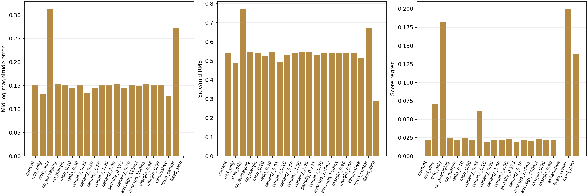
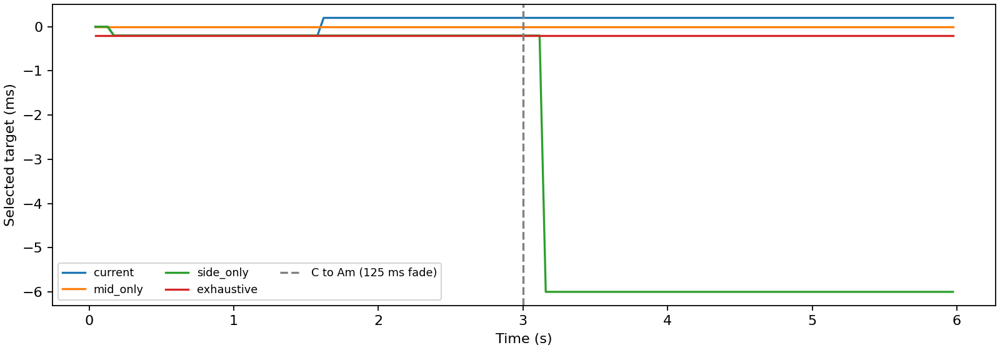
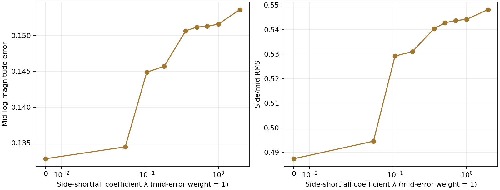
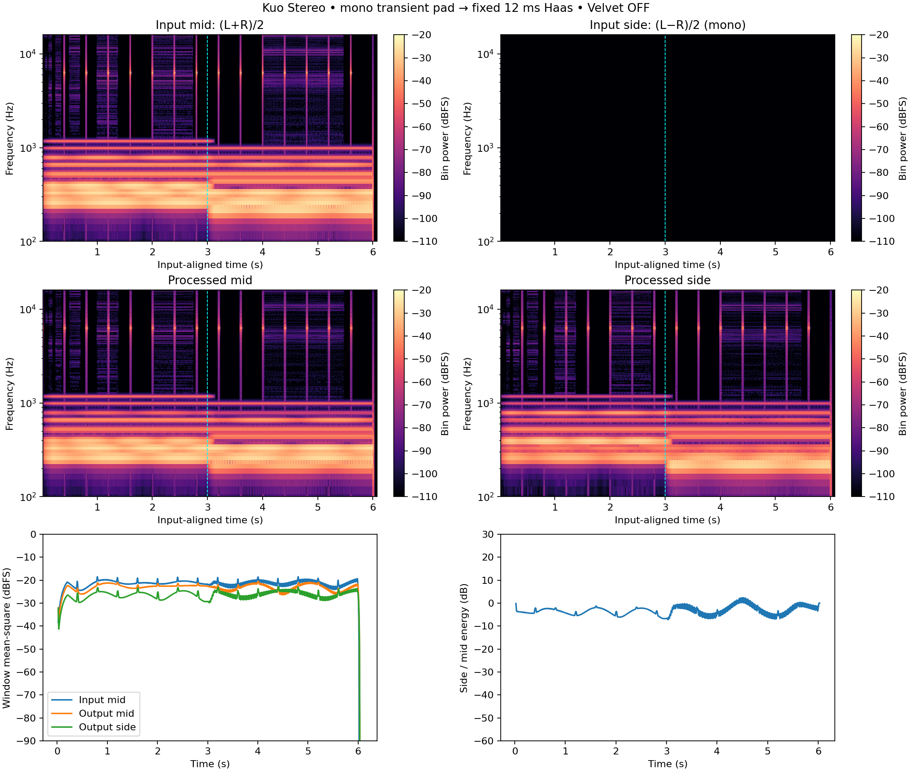

# Kuo Stereo: synthetic score ablations

134,200 snapshot/variant observations. All signals are generated locally; no recordings or listening results are implied.



| Variant | Mid log error | Side/mid RMS | Regret | Change fraction |
|---|---:|---:|---:|---:|
| current | 0.1507 | 0.5403 | 0.0217 | 0.0329 |
| mid_only | 0.1328 | 0.4874 | 0.0716 | 0.0329 |
| side_only | 0.3129 | 0.7723 | 0.1821 | 0.0020 |
| no_averaging | 0.1529 | 0.5465 | 0.0240 | 0.0965 |
| no_margin | 0.1506 | 0.5407 | 0.0215 | 0.0456 |
| ratio_0.10 | 0.1443 | 0.5259 | 0.0247 | 0.0373 |
| ratio_0.30 | 0.1516 | 0.5462 | 0.0225 | 0.0368 |
| penalty_0.05 | 0.1344 | 0.4945 | 0.0612 | 0.0342 |
| penalty_0.10 | 0.1449 | 0.5292 | 0.0197 | 0.0402 |
| penalty_0.50 | 0.1512 | 0.5428 | 0.0221 | 0.0314 |
| penalty_1.00 | 0.1516 | 0.5442 | 0.0224 | 0.0335 |
| penalty_2.00 | 0.1536 | 0.5482 | 0.0239 | 0.0358 |
| penalty_0.175 | 0.1457 | 0.5310 | 0.0189 | 0.0373 |
| penalty_0.70 | 0.1513 | 0.5437 | 0.0222 | 0.0314 |
| average_125ms | 0.1500 | 0.5411 | 0.0209 | 0.0539 |
| average_500ms | 0.1528 | 0.5423 | 0.0238 | 0.0230 |
| margin_0.96 | 0.1509 | 0.5396 | 0.0219 | 0.0283 |
| margin_0.99 | 0.1507 | 0.5399 | 0.0217 | 0.0359 |
| exhaustive | 0.1288 | 0.5145 | 0.0000 | 0.2942 |
| fixed_center | 0.2726 | 0.6723 | 0.1999 | 0.0000 |
| fixed_zero | 0.0000 | 0.2895 | 0.1393 | 0.0000 |

Means pool frames, sample rates, ranges and fixtures equally **per row**, not per recording or listener. The 96 kHz cases have more frames. Fixed-zero rows exist only for the 0 ± 6 ms search range, so compare them with the corresponding subset of other methods rather than their full-matrix means. Inspect `haas.csv.gz` for per-case results; these are descriptive statistics without independent-trial confidence intervals.



## Protocol and score

The native worker's real `process` method receives chronological snapshots synchronously after its thread is stopped. No timing sleeps, worker races or audio-stream scheduling determine the result. Analysis size and hop are 2,048 samples. Four fixtures are a mono C-to-Am pad, correlated stereo pad, already-wide stereo pad, and a pad with 400 ms-spaced, 6.3 kHz exponentially decaying short bursts. The deterministic existing SynthPad generator changes chord at 3 s over 125 ms. Six seconds are processed at 44.1/48/96 kHz. Center ± Variability settings are 0 ± 6, 12 ± 6, and −28 ± 2 ms. The last case reaches the negative boundary. All candidates are on the production 0.2 ms grid.

For each candidate d, the reference and processed mid signals are Hann-windowed and transformed. With FFT size N, r_k=|FFT(mid)|/N, p_k=|FFT(mid_d)|/N, and w_k=r_k/(r_k+0.01), the spectral error is

`E(d) = sum(w_k * abs(ln((p_k+0.0001)/(r_k+0.0001)))) / max(sum(w_k), 1)`

Bins 2 through N/2−1 are used. A reference-magnitude sum below 0.001 takes the center-delay fallback rather than searching. Let R be the square root of Hann-weighted candidate side energy divided by max(candidate mid energy, 0.000001). The combined objective is `J(d)=E(d)+0.35*max(0,1−R/0.20)`. This is a width-shortfall penalty, not an unlimited reward for added side energy. Newly measured scores use `alpha=1−exp(−elapsedFrames*2048/(0.25*sampleRate))`; unmeasured candidates retain their previous score. A switch normally requires the proposed averaged score to be <0.98 of the incumbent score.

Ablations remove each term, averaging, or the margin independently. Sensitivity pairs vary target ratio (0.10/0.30), penalty (0.175/0.70), averaging (125/500 ms), and margin (0.96/0.99). All reported quality metrics still use the original combined objective. The exhaustive baseline evaluates every candidate on the identical snapshot without averaging or margin. Its raw minimum is the oracle; **regret is instantaneous raw combined score minus this minimum**. It intentionally includes temporal smoothing lag as well as incomplete search. Fixed-center and in-range fixed-zero baselines use that same spectral evaluation, without searching.

Exact-mono mirrored scores must match within 1e−6, verifying that this objective cannot infer the preferred delay sign. An anti-phase input with silent mid must take the center-delay fallback. These invariants are asserted, as are index/range bounds, finite scores, and nonnegative regret. No assertion requires a research variant to sound better.

## Mid-difference versus side-energy weight sweep



With spectral-error weight fixed at 1, λ spans **0, 0.05, 0.10, 0.175, 0.35, 0.50, 0.70, 1.00, 2.00** in `E + λ*max(0,1−R/0.20)`. The side-only ablation supplies the complementary zero-spectral-weight extreme. `weight-sweep.csv` and the full frame table retain the measured results. Each weight uses exactly the same input snapshots and production temporal/search logic. The criterion is the production side/mid **shortfall**, not an unbounded side-energy reward. These paired comparisons measure a trade-off; they do not select an optimum by listening preference. This mechanism is in **Kuo Stereo**, while Xuan Phase's current alignment algorithm has no such weighted score.

## Limits

The snapshot ablations above isolate target selection. Their score metrics do **not** render delay slew, the Dynamic transient envelope, Velvet, the 1.5 ms lookahead, or final mono fold-down. The separate audio experiment below renders fixed Haas with Velvet off through the full path; adaptive delay slew remains outside that experiment. An exact zero delay can remain suitable for already-stereo input with enough side energy. Magnitude deviation is not waveform or phase preservation. `switching.csv` measures target changes; it does not call those changes perceptually useful. `search_us` is a single synchronous wall-clock observation including FFT work and research instrumentation, not an audio-thread CPU benchmark or a portable timing threshold. No loudness normalization is applied.


## Rendered mid and side audio



Six seconds of the deterministic mono C→Am pad plus 400 ms-spaced bursts pass through the **full production audio path** at 48 kHz, in 128-sample blocks. A neutral 0 ms Haas/0% Velvet render must reproduce the latency-aligned input and have silent side. The illustrated condition uses fixed 12 ms Haas, zero Variability, **Velvet OFF (Width 0%)**, 80% Transient protection, zero Dynamic and Attack, all Velvet bands 100%, Output 0 dB. Only the declared 72-sample host latency is removed; the intentional Haas delay remains. The render includes a 100 ms zero-input tail. The cyan line marks the 3 s chord change.

`M=(L+R)/2`, `S=(L−R)/2`; no channel or image normalization is applied. The ratio trace is hidden where mid energy is below −80 dBFS. Integrated rendered mid energy is -23.03 dBFS and side energy -26.22 dBFS (side/mid -3.20 dB). This Haas-only full-path example complements the search snapshots: it does not evaluate adaptive worker scheduling or claim exact mid preservation with Haas enabled. Raw aligned samples are in `audio-neutral.csv.gz` and `audio-wide.csv.gz`.

All spectrograms derive from native sample captures, using NumPy FFTs and Hann windows without boundary padding. One-sided per-bin power is `|FFT(x*w)|²/(N*sum(w²))`, doubling interior bins; its sum is the window-weighted mean square (0 dBFS = mean square 1). Kuo uses 2,048/256 samples (window/hop), Zao 4,096/256, Xuan 512/32, all at 48 kHz. Phase is masked in silence. Raw captures are gzip-compressed beside this report.

## Reproduce

From the repository root, run:

```sh
python3 projects/run_academic_tests.py --output build/academic-results
python3 projects/generate_academic_reports.py build/academic-results --publish
```

CMake 3.22+, a C++17 compiler and the normal JUCE system dependencies are required. Plot generation additionally needs Python `numpy` and `matplotlib`. Native tests and CTest do not require Python plotting packages. Detailed CSV files are gzip-compressed alongside this report; `provenance.json` records source hashes and build information when run through the launcher. Timing values are machine-dependent.
