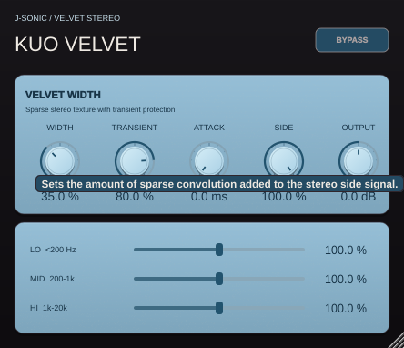

# Kuo Velvet

Kuo Velvet isolates Kuo Stereo's Velvet widening stage as an independent J-SONIC
plugin, with pale-blue styling, one-sentence hover hints, and a 50–120%
scalable editor. Its 444 × 382 panel places Width, Transient, Attack, Side,
and Output in one row, with three band sliders below.



Kuo Stereo and Kuo Velvet now use the **same** `KuoStereo/Source/VelvetStage.h`.
The shared stage retains its deterministic 16-tap sparse convolution, four-band
spectral onset detector, Transient and Attack controls, and smoothed Width.
Opposite additions to left and right preserve the input mid signal before
Output gain. Width scales the added convolution side signal; it does not
crossfade away the original audio. Lo (up to 200 Hz), Mid (200 Hz–1 kHz), and
Hi (1–20 kHz, up to Nyquist) scale the signal fed to Velvet convolution from
0 to 200%. At 100% each band, they recombine to the full-band input. Side
scales the combined original and generated stereo side at the final stage:
0% makes the output mono and 100% preserves its full side signal. Side changes
are smoothed over 15 ms. The meters and meter updates remain removed.
At zero Width, the shared stage skips convolution tap reads once the Width
fade reaches silence. The onset detector and input history remain live, so
Haas protection in Kuo Stereo and reactivation retain current signal history.
Bypass does not suspend the selected processing path.

There is no Haas delay, FFT candidate search, or search worker in Kuo Velvet.
The original 1.5 ms lookahead is retained and reported to the host (72 samples at
48 kHz). The Bypass button and host bypass preserve that delay and the original
input level. Nine parameters support automation and state restoration. Mono
input can route to stereo output; centered mono material gains stereo width.
Output spans −12 to +12 dB.

## Build and test

From the repository root, with CMake 3.22+, C++17 and the platform's JUCE dependencies:

```bash
cmake -S projects/KuoVelvet -B build-velvet -DCMAKE_BUILD_TYPE=Release
cmake --build build-velvet --config Release --target KuoVelvet_VST3 KuoVelvet_Standalone KuoVelvetTests --parallel 2
ctest --test-dir build-velvet -C Release --output-on-failure
```

macOS also exposes `KuoVelvet_AU`. Bundle output is under
`build-velvet/KuoVelvet_artefacts/Release/`. Linux binaries require Linux hosts.
To regenerate the native tooltip preview on Linux:

```bash
xvfb-run -a build-velvet/KuoVelvetTests --editor "$PWD/projects/KuoVelvet/Previews/kuo-velvet-tooltip.png"
```

See [TOOLTIPS.md](TOOLTIPS.md) and [Tests/REPORT.md](Tests/REPORT.md).
