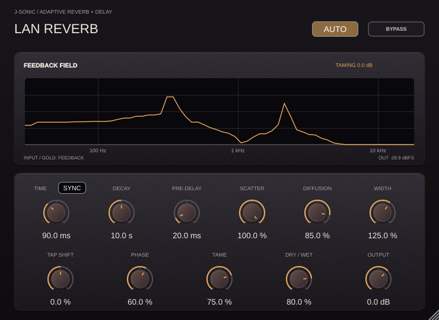

# Lan Reverb

A stereo reverb/delay for long, wide tails and high wet mixes, with automatic
feedback resonance control. Version **0.5.0**, by **J-Sonic Team**, **2026**.



## Controls

| Control | Range / default | Function |
|---|---|---|
| Time | 20–500 ms / 90 ms; note lengths with Sync | Repeat time at zero Scatter; reference room size at full Scatter |
| Sync | Off | Switches Time between milliseconds and DAW-synchronized note lengths |
| Decay | 0.3–40 s / 10 s | Nominal RT60, with further loss from damping, interpolation and automatic EQ |
| Pre-delay | 0–200 ms / 20 ms | Delay before the wet network; dry remains immediate |
| Scatter | 0–100% / 100% | Morphs regular stereo delay into a dense stereo reverb |
| Diffusion | 0–100% / 85% | Fine mixing density as Scatter increases |
| Width | 0–200% / 125% | Normalized wet mid/side balance; zero is mono |
| Tap Shift | −100–100% / 0% | Offsets feedback read positions by different amounts per line |
| Phase | 0–100% / 60% | All-pass phase dispersion and automatic phase/tap steering |
| Tame | 0–100% / 75% | Strength of narrow automatic feedback EQ, sharing a 6 dB total cut budget |
| Shimmer | 0–100% / Off | Adds a +12-semitone, 2× oversampled layer to the source feeding the delay network |
| Low shelf handle | 40–2,000 Hz / 200 Hz; −12–+6 dB / 0 dB | Drag its L node horizontally for frequency and vertically for gain |
| High shelf handle | 2,000–16,000 Hz / 8,000 Hz; −12–+6 dB / 0 dB | Drag its H node horizontally for frequency and vertically for gain |
| Dry / Wet | 0–100% / 80% | Linear mix, including true full-wet operation for sends |
| Output | −24–12 dB / 0 dB | Final output gain |
| Auto | On | Enables input-aware spectral peak analysis and automatic correction |
| Bypass | Off | Returns immediate dry audio while keeping the tail and analysis hot |

The ebony-and-gold editor matches the collection, scales from 50% to 120%, and
provides one-sentence control hints. Hover over its title for developer, year,
and version. The plot compares input and feedback power spectra; gold markers
indicate tracked resonance bands. A pale target EQ curve combines the narrow tamer filters with the two uncompensated shelves. The reduction readout shows the deepest
requested EQ cut, not a broadband gain-reduction meter.

## Tempo-synchronized Time

Enable **Sync** beside the Time label to select musical note lengths with the
same knob: 1/64 through 1/1, including triplet (**T**) and dotted (**D**) values.
The choices increase in duration around the knob; the default synced value is
1/8. With Sync off, Time returns to its stored 20–500 ms value. The free time,
note selection and Sync state are separately automated and saved in sessions.

The processor reads the DAW's tempo each callback, including while transport is
stopped. A quarter note is 500 ms at 120 BPM, a dotted quarter 750 ms, and a
quarter-note triplet about 333.33 ms. Delay times follow host tempo changes
through the existing queued 250 ms tap crossfades; this follows tempo, rather
than resetting the echo phase to the bar on playback. Scatter 0% gives regular
note-timed repeats, while higher Scatter uses the selected note as the reference
for its spread delay lengths. Pre-delay remains an independent millisecond value.

Supported host tempo is 20–400 BPM; missing, invalid or unsupported data retains
the last valid value, initially 120 BPM in standalone or without host tempo.
The longest choice is a dotted whole note (18 s at 20 BPM). Delay buffers are
reserved during prepare so tempo automation never allocates memory on the audio
thread. This increases reserved delay memory to roughly 42 MB at 48 kHz and
scales with sample rate, independent of the current Time setting. Host latency
remains zero; the reported tail is 120 s with neutral/cut shelves and potentially
infinite with either shelf boosted.

## Delay to reverb with Scatter

**Scatter 0%** aligns all delay lines to Time, disables inter-line mixing and
phase spreading, and reads them through input-aligned stereo pickups. This gives
regular, independent left/right delay repeats rather than eight unrelated echoes.
Pre-delay still offsets the first repeat; Tap Shift moves their common feedback
delay, and automatic EQ can still tame ringing. Phase and Diffusion introduce no
spreading at this endpoint. Mono input stays mono before intentional Width changes.

As Scatter rises, delay lengths separate, phase spreading enters the loop, and
the output pickups rotate toward the stereo reverb field. **Scatter 100%** uses
the full spread and phase network. Diffusion fine-tunes feedback mixing from 25%
to 100% of the full rotation at that endpoint, so its minimum does not disable
the reverb. Scatter defaults to 100% and is smoothed over 50 ms; tap changes keep
their queued 250 ms crossfades. Intermediate settings may have additional decay
loss from the phase-path blend, so Decay remains a nominal control.

## Signal path

`input → wet pre-delay → original + Shimmer octave layer → input injection → delay-line writes`

`delay-line wet taps → stereo pickups → Width → dry/wet mix → Output`

`separate feedback taps → narrow tamer EQ → uncompensated shelves → phase dispersion → damping → orthogonal mixing → feedback gains → delay-line writes`

The wet return is read **before** EQ, phase processing and loop damping. Those
stages process only the recirculated signal, which is added to the independent
input injection at the next delay-line write. They can change later repeats,
but never act as inserts on the wet output or dry signal. Manual Tap Shift and
automatic phase-guided tap steering move the feedback read heads only; the wet
read heads retain the Time/Scatter spacing. Automatic feedback gain adjustments
also do not change the source injection gain.

Two different projections of the network form the wet stereo output. Width is
applied **outside** the feedback loop, then mixed with the immediate dry path.
Stereo input is retained, and matched mono input/output is also supported.

Three stages of Givens rotations mix the feedback lines orthogonally at every
Diffusion setting. This avoids the loss of tail energy caused by interpolating
between identity and a fixed matrix. Per-line gains use
`min(0.9995, 10^(−3 × nominal_loop_seconds / Decay))`, including the Scatter-scaled feedback phase-delay
buffer length. This describes a nominal RT60, not an exact broadband decay:
18 Hz DC/bass damping, a high-frequency low-pass, fractional delay interpolation,
EQ, and time variation change the measured result.

The phase branch now has **three independently tracked automatic all-pass
sections per feedback line**, so all three detected resonance bands can guide
phase correction simultaneously. Frequency, detected width and resonance
strength determine each section's target, and the Phase knob scales its depth.
Sections retain their identities when the detector changes band priority.
The existing manual diffuser remains ahead of these sections.

Phase processing is deliberately subtle: the combined delay budget is **5 ms**,
allocated as 1 ms maximum group delay for the manual diffuser, 1 ms for each
of the three automatic sections, and at most ±1 ms of automatic feedback-tap
steering. This is independent of the intentional Time, Pre-delay and manual
Tap Shift settings. Automatic tap offsets no longer grow with long synchronized
notes. The manual diffuser's underlying delays are now approximately
0.25–0.775 ms. Its coefficient limit bounds its worst-case group delay.

Each automatic section is a second-order all-pass implemented with two
normalized scattering junctions. The pole radius and center are constrained
throughout parameter ramps so each section's frozen group delay stays within
its 1 ms budget. Frequency focus is broadened where necessary to respect that
limit; these are not arbitrary narrow filters with unlimited group delay.
The fixed response has unity magnitude. Normalized junctions preserve joint
signal/state energy during modulation, avoiding feedback gain from changing
biquad coefficients. Alternating lines use different modest phase targets.
The target excursion is at most 22.5° or 45° beyond a two-sample baseline before
strength scaling and delay constraints; it is not a guarantee of that exact
angle after constraints or after combining bands.

**Phase coefficient changes ramp over 250 ms**, including release when Auto
or Phase turns off. Inactive automatic sections settle to two-sample pure
delays rather than retaining high-Q poles; the three sections' six samples are
included in the nominal loop-time gain calculation. Phase 0 retains this short
baseline and the manual diffuser's pure delay. Scatter 0 bypasses the complete
phase branch. Dry and first wet arrivals still bypass all phase correction.

The 5 ms bound describes the phase branch and automatic tap offsets, not the
whole reverb delay or EQ/damping group delay. Intermediate Scatter settings and
tap crossfades combine paths and can introduce combing; they are not a guarantee
of a flat magnitude or uniformly bounded composite group delay during morphing.
These operations alter feedback reinforcement; EQ supplies explicit attenuation,
and automatic phase processing does not yet measure whether each new target
improves the resulting tail.

**Tap changes take 250 ms** through a convex quintic crossfade between old and new
read positions, with later requests queued until the current fade finishes.
Pre-delay uses the same transition. This avoids abrupt read-head jumps and
continuous Doppler sweeps, although changing a populated delay network can still
produce audible coloration or modulation.

## Draggable feedback shelves

Drag the **L** and **H** handles on the spectrum horizontally to choose each
shelf's transition frequency and vertically to set its gain. Double-click a
handle to restore its default frequency and 0 dB. Both axes support host
automation and session recall, and remain usable at 50%–120% UI scaling.
The curve shows the requested response; the feedback filter banks follow it
through their existing 20 ms warm-up and 250 ms crossfade.

Shelves process **feedback only**, including when Auto is off. They do not
filter the dry signal or the first wet arrivals. Both shelves range from
−12 dB to +6 dB, with the same limits for dragging and host automation.
Positive gain is applied directly, with **no compensation** or reduction of
other frequencies. Boosted bands can exceed unity around the feedback loop
and grow after the input stops, even though the nominal Decay gains remain
below unity. Auto/Tame remain available, but do not guarantee stabilization.

## Shimmer input layer

**Shimmer** feeds the incoming wet source into a +12-semitone phase vocoder
running at **2× the host sample rate**, with FIR anti-imaging and anti-aliasing
filters around the pitch shifter. The knob adds 0–100% of that octave-up signal
to the original source at the feedback-network injection. The original source
is retained at its existing level. The recirculating feedback is not repeatedly
pitch shifted, so this is one added octave rather than a recursively rising
pitch staircase. Shimmer follows wet Pre-delay, then adds its own STFT timing.

The stereo vocoder uses a 2,048-sample FFT and 512-sample hop at the oversampled
rate, with instantaneous-frequency phase tracking for off-bin notes and four
Hann-window overlaps. Its wet layer has intentional analysis/conversion delay
and can soften transients; the dry path still reports zero latency. Source
protection and the grey input spectrum include the generated octave so that
the tamer does not mistake it for an unintended resonance.

The send changes over 250 ms. At Off, both the phase vocoder and its FIR
converter stop to save CPU; reenabling clears stale pitch buffers. Host or
plugin bypass keeps an enabled Shimmer running with the rest of the network.
Adding the octave can raise wet levels, so Output remains available for gain
adjustment. No automatic output normalization is applied.

## Automatic resonance control

A background worker transforms a 4,096-sample Hann-windowed frame at up to
10 updates/s. It sums channel powers rather than cancelling anti-phase stereo.
Input peaks are protected before feedback candidates are scored. A robust
neighboring-bin median preserves quieter notes beside loud partials; peaks
within 60 dB of the strongest input bin and above the absolute noise floor are
eligible. Strong peaks receive an absolute guard of 4% of (Decay + 1.25 s),
clamped to **250–650 ms** after they leave the input; weaker 6–12 dB peaks use
200 ms. Protection covers neighboring bins and revokes overlapping held cuts
when a new note arrives.

After this short guard, remembered source identity becomes conditional rather
than a blanket veto. The worker fits **dB-per-second decay slopes** across eight
frames (normally 0.7 s), requiring at least six frames. Each peak's three-bin
power is compared with the median decay of at least three populated bands from
a 24-band logarithmic reference spectrum, excluding the candidate's band and
its immediate neighbors. The reference must decay
faster than 0.6 dB/s, and the candidate must decay at least 35% more slowly, with
an additional advantage above max(0.6 dB/s, 20% of the reference rate). Clearly
rising peaks are excluded from this relative-decay evidence. Equal-rate tails,
regardless of their original spectral levels, and single tones with no usable
reference do not supply evidence to override source memory. The remembered
identity expires after Decay + 1.25 s; source notes still present in the input
remain guarded. A stream gap above 300 ms clears slope history.

Up to three separated bands receive attenuation-only cuts capped at **6 dB**
before Tame scaling (4.5 dB for one band at the default 75%). The stages share
a 6 dB total attenuation budget: if their requested cuts sum above that value,
they are scaled together. This guarantees a static combined tamer response no
deeper than −6 dB, even if bands overlap; shelf cuts are separate from this limit. Without comparative decay
evidence, a feedback peak must exceed its neighborhood by 8 dB beyond input
prominence and persist for about 300 ms. Strong slow-decay evidence lowers this
to 6 dB and about 200 ms, raises priority and increases the requested cut within the same 6 dB cap.
The EQ bandwidth is half the detector's tracked width, with Q up to 28 rather
than 14. The source-protection/detection widths remain unchanged. Filtering
is still limited by the accuracy of the FFT-derived center frequencies. This is not a
continuous-frequency detector. Held notches release with a **1.2 s** time
constant, reducing the influence of old decisions.

Two fixed filter banks warm for 20 ms and crossfade over 250 ms, preventing
coefficient jumps. The callback neither runs FFTs nor waits for the worker; it
uses a bounded single job slot and lock-free atomic result publication. Missed
jobs are dropped rather than queued without bound. Auto Off stops analysis submissions; so does Tame at zero when Phase is zero
or Scatter is zero. Phase still supplies its static
manual dispersion when Auto is off and Scatter is above zero.

Protection favors preserving observed musical content while a note is present
or within its short guard; later, measured slow decay can identify ringing at
the same frequency. Sparse or ambiguous tails retain source protection. Source history is
retained across Auto toggles and aged by stream time; preparing a new stream
clears it. Source peaks must have been observed while analysis was enabled.

The feedback-write soft limiter has been removed. The loop can build levels
above the previous magnitude-3 per-line ceiling and produce unstable tails;
there is no feedback or output level limiter. Nonfinite host inputs and delay
writes are still replaced with zero as numerical housekeeping, rather than
limiting finite audio amplitudes. The plugin cannot guarantee resonance removal
or bounded levels on arbitrary material or external feedback arrangements.

With either shelf boosted, the processor reports a **potentially infinite tail**
to the host, including VST3's infinite-tail flag. With both shelves neutral or
cut, it retains its ordinary 120 s tail report.

## Build and verify

```sh
cmake -S projects/LanReverb -B build/lan -DCMAKE_BUILD_TYPE=Release -DLAN_REVERB_BUILD_TESTS=ON
cmake --build build/lan --target LanReverb_VST3 LanReverb_Standalone LanReverbTests --parallel 3
./build/lan/LanReverbTests --report /tmp/lan-reverb-report
python3 projects/LanReverb/Tests/generate_report.py /tmp/lan-reverb-report --publish
```

On Linux, run GUI-linked tests under `xvfb-run -a` if there is no display. For a
native preview, use `LanReverbTests --editor /tmp/lan-reverb.png`; the repository's
`projects/ZaoDrive/Tests/with_x11_atoms.py` helper seeds window-manager atoms for
minimal Xvfb environments. Plot generation needs Python `numpy` and `matplotlib`.

macOS also provides `LanReverb_AU`; the root `build-macos-all.sh` discovers this
project automatically. Windows workflows are unchanged. The latency reported to
the host is **zero samples**; wet pre-delay and feedback delay remain intentional
effect timing. The tail report is 120 s with neutral/cut shelves and potentially infinite with shelf boost.

See the [test report](Tests/Reports/README.md) for reproducible measurements and
scope, and [TOOLTIPS.md](TOOLTIPS.md) for the complete hover text.
