# Lan Reverb engineering measurements

Version 0.5.0. These are reproducible synthetic engineering tests, not listening results or a claim that every resonance can be removed.

## Source protection and feedback-only correction

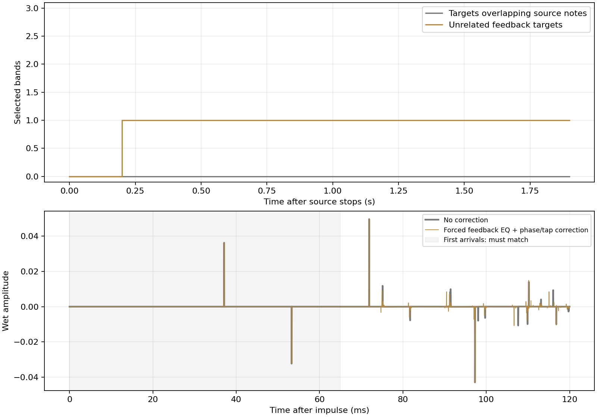

Three-rate spectral tests (44.1/48/96 kHz) use a 220/329.7/997.3 Hz chord with a quiet 997.3 Hz partial, added noise, and anti-phase stereo. The corresponding feedback partial is louder and offset by 0.6 FFT bins. Source peaks must not become EQ or automatic phase/tap targets, even when the feedback spectrum is much more tonal. After the source stops, its peaks remain protected while an unrelated 1,800 Hz feedback component is detected. A separate test makes previously ringing frequencies appear in the input and requires their held targets to be revoked. Service-level tests also verify that observed-note protection survives Auto Off/On and expires correctly with elapsed stream time.

Strong source peaks use a median neighborhood to avoid loud neighboring notes masking a quiet partial. Their absolute guard is now only 4% of (Decay + 1.25 s), clamped to 250–650 ms; weaker peaks use 200 ms. Afterwards, soft source identity prevents cuts unless the relative decay comparison supplies evidence. Filter-band overlap is vetoed as well as exact-bin matches while the guard is active. The report's protection trace shows selected targets, not output gain. Its stationary tail supplies no relative-decay evidence, so remembered notes stay protected even after the short guard expires.

For routing, a test-only friend preloads actual feedback filters at sixteen logarithmically spaced frequencies from 150 Hz to 12 kHz (−0.375 dB each) and requests low/high shelf gains of −9/−3 dB, then forces a phase/automatic-tap target before rendering an impulse. The ordinary reference has no correction. At Time 80 ms, Scatter 100%, Pre-delay 0 and Width 100%, the first arrivals before 65 ms must agree within 2e−7 at all three sample rates; later returns must differ. This verifies that the correction is active **inside the feedback return**, rather than proving equality with an accidentally bypassed processor. Separate wet and feedback read heads, plus independent source injection gain, prevent automatic tap/gain changes from altering the first arrivals. Recirculated audio naturally carries the corrections on subsequent repeats; there is no EQ or phase insert on the wet output.

## Relative frequency decay and stronger taming

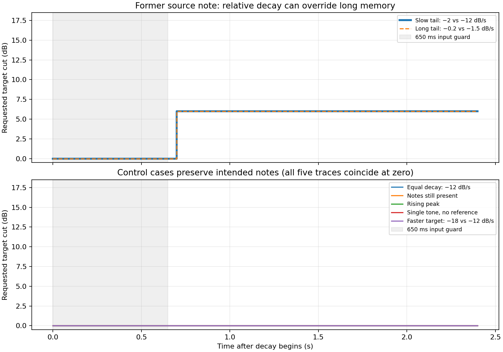

At 44.1/48/96 kHz, seven bin-centered tones near 187.5/375/750/937.5/1,500/3,000/6,000 Hz are first observed in the stereo input. The 187.5 Hz tone starts at amplitude 0.3; all others start at 0.03, so the loudest note is not the intended target. Soft source memory is set to 30 s, but its absolute guard is only 650 ms. After input stops, the target near 937.5 Hz decays at −2 dB/s while the others decay at −12 dB/s. A second positive case uses −0.2 versus −1.5 dB/s to represent a long reverb tail. Both must acquire the target and request more than 3 dB attenuation within the 6 dB limit, well before the old 30 s protection would expire. Other originally observed notes must remain untargeted. The requested per-band cap is now 6 dB before Tame scaling; the engine also shares a 6 dB total budget across simultaneously active cuts.

Negative controls use equal −12 dB/s decay, continuously present input notes, a rising +8 dB/s target, a single tone without reference bands, and a faster −18 dB/s target. None may acquire the target. These are direct production-analyser tests with controlled spectral envelopes, not full reverb renders or acoustic decay estimates. Each regression uses up to eight frames and actual sample timestamps; the reference is the median of at least three populated logarithmic frequency bands excluding the target and its immediate neighboring bands. The input guard and persistence still delay acquisition. All cases are written to `relative-decay.csv.gz`.

## Scatter: delay to reverb

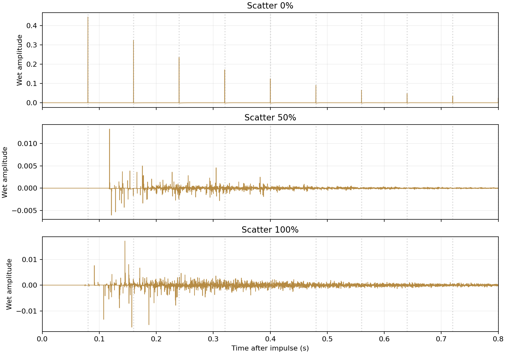

The new 0–100% Scatter knob is measured at 0%, 50%, and 100% with Time 80 ms, Pre-delay 0, Decay 3 s, Diffusion 100%, Phase 100%, Width 100%, Mix 100%, Output 0 dB, and Auto Off. Input is the same 0.8 impulse in both channels. At zero, phase spreading and inter-line mixing are bypassed and every line uses the same delay, even though Phase and Diffusion are at maximum. Input-aligned pickups prevent the coincident lines cancelling at the output. Full Scatter spreads the delays and activates the dense reverb network.

| Rate (kHz) | Scatter | First return (ms) | Energy in repeat windows | Active tail samples |
|---|---:|---:|---:|---:|
| 44.1 | 0% | 80.00 | 99.99% | 4.92% |
| 44.1 | 50% | 58.55 | 1.39% | 35.75% |
| 44.1 | 100% | 37.10 | 10.45% | 82.95% |
| 48 | 0% | 80.00 | 99.99% | 4.69% |
| 48 | 50% | 58.54 | 1.75% | 45.58% |
| 48 | 100% | 37.08 | 9.61% | 84.13% |
| 96 | 0% | 80.00 | 100.00% | 2.61% |
| 96 | 50% | 58.54 | 1.24% | 15.87% |
| 96 | 100% | 37.09 | 8.30% | 69.90% |

Repeat windows are the first 12 ms after each multiple of 80 ms. Their energy fraction uses the whole one-second stereo render. Active-tail fraction counts left-channel samples above 0.1% of that render's own peak between 0.2 and 0.8 s; it measures reflection density, not loudness or decay quality. Tests require zero Scatter to return within one sample of Time and place over 98% of impulse energy in regular repeat windows, while full Scatter produces more than twice the active-tail density. A left-only impulse also verifies that zero Scatter preserves independent channels at Width 100%. Further checks cover 50 ms-smoothed endpoint automation and stopping phase-only FFT work when Scatter zero makes that work inaudible.

All remaining measurements below use Scatter 100%. Intermediate settings can introduce additional decay loss; the morph is not a claim of constant RMS or identical RT60 at every position. The input-aligned and reverb output vectors rotate smoothly, while feedback taps retain their queued crossfades.

## Narrower tamer, six-decibel cap and feedback shelves

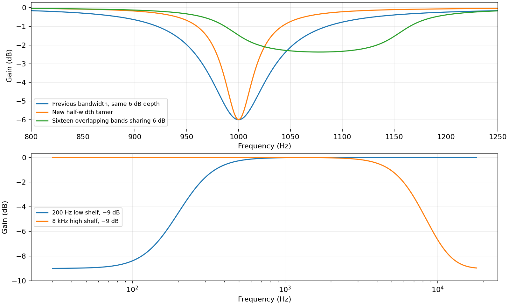

A single 1 kHz tamer band at maximum strength must measure −6 dB at its center and approximately half the previous half-depth bandwidth. The comparison holds depth at −6 dB in both conditions to isolate width, rather than comparing the old 18 dB depth. The EQ uses half the detector's width and allows Q 28; the source-protection and detection widths are unchanged. Sixteen deliberately overlapping test bands from 1,000 to 1,150 Hz at 10 Hz intervals must never exceed 6 dB of combined attenuation across 4,096 sampled frequencies. The shared cut budget provides the corresponding static bound even between sampled points.

Direct production shelf filters verify bass/treble selectivity. Exhaustive corner tests span 8/44.1/48/96/192 kHz, both 20 Hz/20 kHz frequency endpoints, gains −12/0/+3 dB, and 128 spectral points for every combination. Each raw shelf cascade must remain between the sums of its negative and positive gain endpoints. Separate tests require actual low/high boost near +3 dB while the opposite band remains neutral, verifying that no compensation is applied. A rendered impulse through the actual feedback bank (tamer plus both shelves) must match the display curve at 100/1,000/10,000 Hz. The source-routing test above enables shelves too and still requires unchanged first wet arrivals. Additional checks verify fractional transition frequencies outside the former bass/treble limits, clamping legacy +6 dB requests to +3 dB, and a 98%-of-Nyquist frequency ceiling at 8 kHz. Native editor tests drag the low shelf to 16,000.5 Hz and the high shelf to 80.25 Hz, verify host updates and the +3 dB drag/automation cap, double-click reset and scaled hit testing. The pale curve shows target settings; audio follows through the 250 ms bank transition.

## Bounded sustained feedback

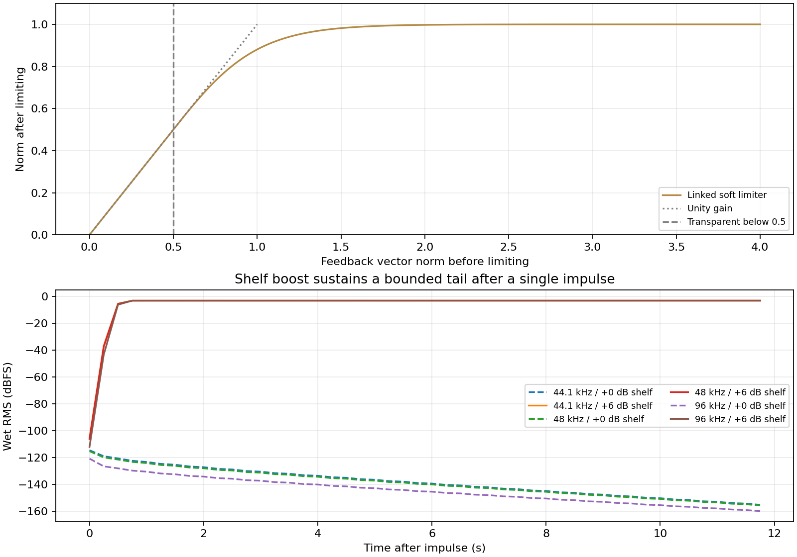

A linked limiter measures the norm of the eight returning feedback lines after nominal decay gain and before fresh input injection. It is exactly transparent at norms up to 0.5, then smoothly approaches norm 1. A single gain preserves the line ratios. Unit tests verify monotonicity, bounded output, transparency, shared scaling, extreme finite values and nonfinite containment. A sub-knee feedback vector must survive 100,000 unity-gain circulations bit-for-bit unchanged: the limiter adds no leakage or mandatory decay.

At 44.1/48/96 kHz, a stereo 0.001-amplitude impulse feeds Time 20 ms, Decay 40 s, Pre-delay 0, Scatter 0%, Phase 0%, Width 100%, Mix 100%, Output 0 dB and Auto Off. The low shelf is at 2 kHz, either neutral or +3 dB, and the high shelf remains neutral. Twelve seconds are rendered after that single impulse. Boost enters through the 20 ms warm-up and 250 ms EQ fade. Boosted 10–12 s tail power must exceed the neutral result by a factor of 1,000 and remain audible; it must stay within a factor of two of its own 6–8 s power, demonstrating a bounded sustained level rather than continued growth or forced decay. Every sample in this matched-delay fixture must remain finite and below magnitude 1.001. This verifies twelve seconds of actual sustain, not a finite-duration proof of infinite reverb for every setting.

Further checks run dense reverb with both shelves at +3 dB, Shimmer on, Phase dispersion and Auto Off for four seconds at 8/48/192 kHz; both channels must stay finite and below magnitude 3. A separate louder impulse must produce first wet arrivals above magnitude 1.2, confirming the stabilizer does not clamp fresh source injection or serve as a final output limiter. Existing dry and first-arrival routing checks remain active. Positive shelves retain their uncompensated frequency response and potentially infinite host tail report. Gain balance, damping and spectral correction can still cause some settings to decay; sustained modes may change timbre. The limiter permits sustained feedback rather than guaranteeing a frozen waveform.

## Oversampled octave Shimmer

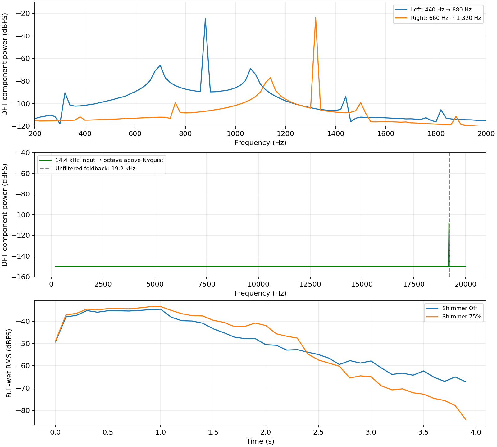

At 44.1/48/96 kHz, the actual stereo Shimmer receives 440 Hz left and 660 Hz right, amplitude 0.2, for one second. The wet outputs must contain 880/1,320 Hz, reject their original pitches by at least 20 dB in component power, and remain finite. An internal sample counter verifies two pitch-processing samples per host sample. The plot uses direct DFT measurements over 0.25–0.85 s in 20 Hz steps, rather than an FFT-bin-center approximation. At 44.1/48 kHz, a second input at 0.3 × sample rate shifts above the host Nyquist; its downsampled output power must remain at least 20 dB below the audible test output, demonstrating rejection rather than alias folding. The 48 kHz example is 14.4 kHz → 28.8 kHz. These are limited synthetic cases, not a complete pitch-shifter quality or alias bound over arbitrary material.

The phase vocoder uses a 2,048-point STFT with 512-sample hops at the doubled rate and Hann overlap-add, between FIR up/down converters. Further checks confirm that Off suspends expensive processing, reenabling cannot replay stale audio, enabled Shimmer stays hot during host bypass, and the generated octave enters the source-protection spectrum without being misidentified as resonance. Zero Mix must preserve immediate dry samples and report zero host latency even with Shimmer and shelf attenuation enabled. The added octave layer has its own intentional analysis/conversion timing.

The lower graph and [four-second Shimmer reverb example](shimmer-reverb.wav) use a one-second mono 220/330/440 Hz chord at amplitudes 0.08/0.06/0.04, followed by a tail. The production engine uses default Time 90 ms, Decay 10 s, Pre-delay 20 ms, Scatter 100%, Diffusion 85%, Width 125%, Phase 60%, Auto On and Tame 75%; Mix is 100%, Output 0 dB, and both shelves are −3 dB at their default 200/8,000 Hz frequencies. Shimmer Off and 75% receive identical input, and their outputs must differ measurably. This layer is added to the incoming source, not repeatedly shifted on each feedback pass. The [isolated stereo octave example](shimmer-octave.wav) contains the direct pitch-shifter test output, without the reverb.

## Multiband phase correction, five-millisecond limit and longer fades

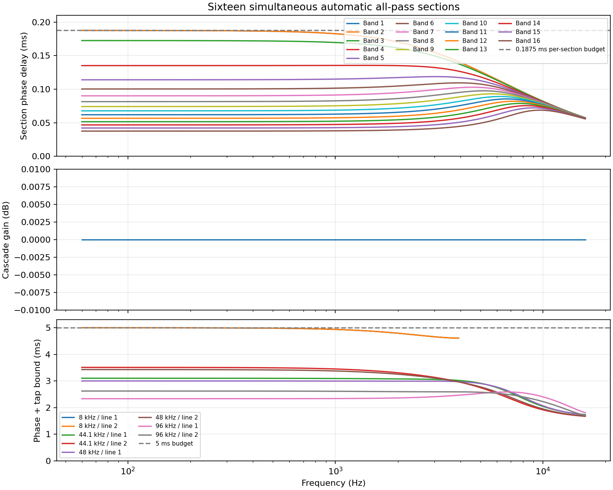

The production analyser must detect sixteen simultaneous anti-phase feedback tones at 8/44.1/48/96 kHz, and all sixteen detections must engage their automatic phase sections. Frequencies start at FFT bin max(8, ceil(100 Hz / bin width)); each following bin is max(previous + 16, ceil(previous × 1.18)), ensuring sufficient separation for the production detector; amplitudes decrease from 0.03 to 0.021. Controlled phase targets use the same frequencies with requested cuts of 6 dB each, independent of the shared Tame attenuation budget. Each section must change phase beyond its inactive two-sample baseline. An impulse rendered through all sixteen normalized lattice sections must agree with the analytical all-pass response and preserve energy; the static cascade must remain within 1e−8 of unity magnitude across the sampled spectrum. The top graph converts unwrapped section phase to equivalent delay; it isolates automatic sections, excluding the manual diffuser and the rest of the reverb.

The lower graph sums the measured sixteen-section group delay with the manual diffuser's conservative worst-case bound and the sample-rate-adjusted automatic tap allowance. This must remain below 5 ms. Separate checks constrain pole radii throughout 250 ms coefficient ramps, verify the fade endpoint, and ensure moving, populated lattice states do not generate energy. Both alternating-line target patterns are checked. Input tones stop after 12,000 samples in the modulation fixture, while targets continue changing every 137 samples for 48,000 samples total. This is a passivity test, not a listening test.

Priority-order swaps must preserve section identities; replacing a secondary frequency must preserve every unchanged neighbor and update its own section at standard audio rates. Matching claims the closest pairs first so a removed resonance cannot steal a neighbor's section. At 8 kHz the tight per-section delay cap can make different target frequencies share the same broad constrained coefficients, so the frequency-tracking assertion is separate from the coefficient-change assertion. Auto Off and Phase 0 release automatic sections to their two-sample baselines. Automatic feedback tap offsets must stay within ±1 ms even with an 18 s synchronized Time. Manual diffuser delays are shortened to approximately 0.25–0.775 ms, and their coefficients are bounded to a 1 ms worst-case group delay; sixteen automatic sections each have a 0.1875 ms budget at standard audio rates. At low sample rates they reserve at least 2.1 samples each, while manual diffuser and tap budgets shrink equally to keep the full limit at 5 ms (0.4 ms each at 8 kHz). The budget covers these phase operations and automatic tap steering, excluding intentional Time, Pre-delay, manual Tap Shift and EQ/damping. Composite paths during Scatter morphs or tap crossfades can comb, so the test does not claim a uniform group-delay bound for those mixtures. Source protection and first-arrival routing tests remain active, now with sixteen forced feedback correction bands.

Tap and pre-delay changes use 250 ms quintic crossfades, checked at three rates, and phase coefficient ramps also finish after 250 ms for fixed targets. The EQ banks retain their 20 ms warm-up and now crossfade over 250 ms. New requests arriving during a tap fade remain queued.

## DAW tempo synchronization

The production processor is connected to a fake JUCE playhead and receives a stereo impulse with Scatter 0%, Pre-delay 0, Width 100%, Mix 100% and Auto Off. Tests measure the first wet sample above amplitude 1e−5, requiring it within 1.1 samples of the requested time at 44.1/48/96 kHz. Cases cover a half note at 120 BPM (1,000 ms, beyond the former 500 ms ceiling), dotted and triplet quarters, and a 1/64 triplet at 400 BPM (6.25 ms, below the free control's 20 ms floor).

| Rate (kHz) | Note index | Host BPM | Expected (ms) | First return (ms) |
|---|---:|---:|---:|---:|
| 44.1 | 16 | 120 | 1000.0000 | 1000.0000 |
| 44.1 | 15 | 120 | 750.0000 | 750.0000 |
| 44.1 | 11 | 120 | 333.3330 | 333.3330 |
| 44.1 | 0 | 400 | 6.2500 | 6.2358 |
| 48 | 16 | 120 | 1000.0000 | 1000.0000 |
| 48 | 15 | 120 | 750.0000 | 750.0000 |
| 48 | 11 | 120 | 333.3330 | 333.3330 |
| 48 | 0 | 400 | 6.2500 | 6.2500 |
| 96 | 16 | 120 | 1000.0000 | 1000.0000 |
| 96 | 15 | 120 | 750.0000 | 750.0000 |
| 96 | 11 | 120 | 333.3330 | 333.3330 |
| 96 | 0 | 400 | 6.2500 | 6.2500 |

Indices 16/15/11/0 mean 1/2, 1/4 D, 1/4 T and 1/64 T in the duration-sorted choice parameter. Additional tests cover callback-by-callback tempo changes, stopped transport, absent transport/BPM/playhead, nonfinite and unsupported tempos, 120 BPM startup fallback, independent recall of free Time and the synced note, and monotonic ordering. Test-only access verifies that wet and feedback read heads fit the prepared buffers at the longest 18 s synchronized setting, all three Scatter endpoints and both Tap extremes with forced automatic correction; this capacity check is separate from the measured shorter impulse renders. The processor supports 20–400 BPM and follows changes through the existing queued 250 ms tap crossfade. There is no bar-phase reset.

## Long, fully wet tails

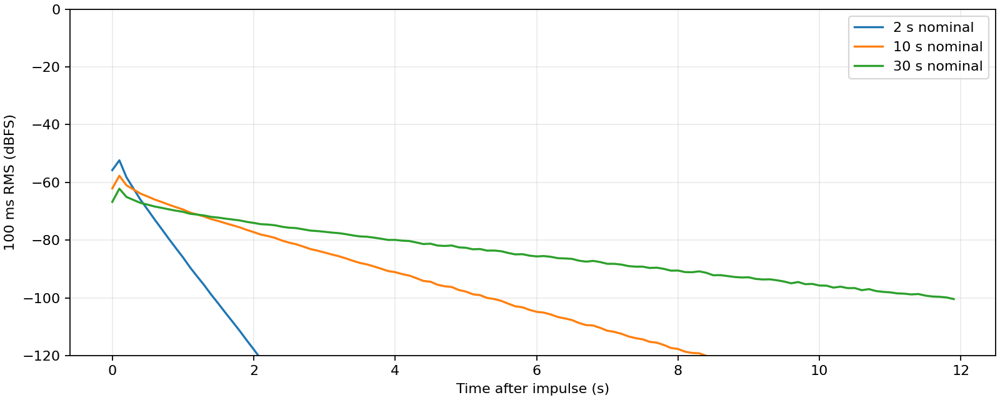

A stereo-linked 0.8-amplitude impulse feeds the real eight-line engine at 48 kHz, with Time 90 ms, Pre-delay 20 ms, Diffusion 85%, Phase 60%, Width 125%, Mix 100%, Output 0 dB and Auto Off. Twelve seconds are rendered at nominal Decay 2/10/30 s. Each plotted point is absolute two-channel RMS over 100 ms; there is no gain normalization. The tests require substantially more 3–4 s tail energy at 30 s than at 2 s. Damping and fractional delay interpolation make the controls nominal, especially at high frequencies. This is not a measured 30 s broadband RT60 fit.

[Eight-second fully wet impulse example](wet-impulse.wav).

## Automatic ringing control

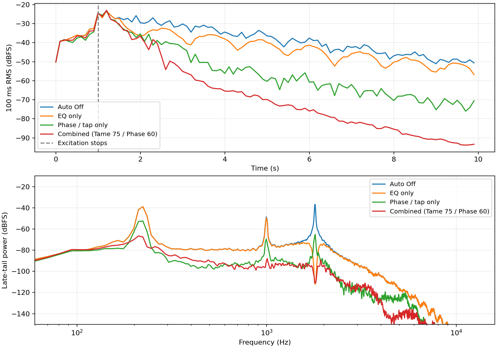

The source contains 220 Hz and 997 Hz tones at amplitudes 0.14 and 0.10 for one second, followed by nine seconds of silence. At one second, a test-only helper adds a 0.08-amplitude 1,800 Hz sinusoid to the eight delay-line histories, signed with the left wet pickup pattern. This controlled in-loop disturbance is absent from the source and can be corrected without treating its intended tones as faults. It is a seeded-state engineering fixture, not a recording or naturally generated resonance claim. Time is 90 ms, Decay 30 s, Diffusion 10%, Pre-delay 20 ms, Width 125%, Mix 100%, and Output 0 dB. Conditions are Auto Off with Phase 0; Auto On with Tame 100% / Phase 0; Auto On with Tame 0 / Phase 100%; and Auto On with the default Tame 75% / Phase 60%. These compare isolated EQ, isolated phase/tap processing, and their combined result. Phase zero retains the short manual diffuser delay plus the sixteen sections' 32-sample baseline in the feedback branch only.

| Condition | Mean late-tail power, 3–8 s | Change from Off |
|---|---:|---:|
| Auto Off | 0.00023569243 | +0.00 dB |
| EQ only | 7.8583423e-05 | -4.77 dB |
| Phase / tap only | 4.3866374e-06 | -17.30 dB |
| Combined (Tame 75 / Phase 60) | 3.0338485e-07 | -28.90 dB |

The deepest requested single-band cut was **6.00 dB**. Tests require a genuine correction request and at least 10% less 1,600–2,050 Hz late-tail energy with feedback EQ. They do not require the legitimate source-note tail to be attenuated. The table shows total late energy separately, including protected notes. The spectrum uses overlapping 4,096-sample Hann windows with 2,048-sample hops over 3–8 s, averaging both channel powers. No output matching conceals attenuation. Phase/tap processing redistributes loop modes and may move energy between frequencies; its result is reported independently rather than required to beat EQ or reduce total energy.

The analyser and feedback filters are production code. Tests run the analyser synchronously at callback boundaries for deterministic results; the shipped plugin runs it in a background worker, whose scheduling can delay or drop updates. The plotted 100 ms RMS windows are independent of the internal FFT windows. The CSV's `max_cut_db` column is the maximum over the entire render, not a time-varying reduction trace.

[Tamed tail example](tamed-tail.wav).

## Manual feedback-tap change during the tail

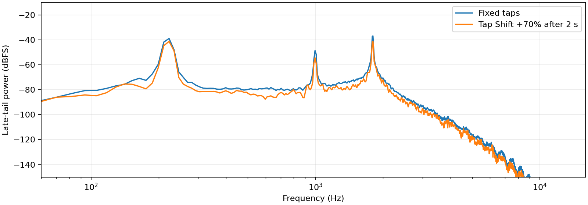

The same source tones, seeded feedback disturbance and settings as the Auto Off condition are rendered again, but Tap Shift changes from 0 to +70% at 2 s, after the source has stopped. Other controls stay fixed. The plot compares 3–8 s tail spectra. The absolute spectral RMS difference relative to the fixed spectrum must exceed 10%; this detects changes in either shape or level without assuming that retiming a stored tone must move its frequency. The normalized shape similarity is 0.979104, the relative spectral RMS difference is 59.37%, and the late-tail power ratio is 0.4318. This directly exercises existing ringing rather than merely changing the settings before excitation. Energy can move into other frequencies; a tap change alone is not an attenuation guarantee.

## Width from mono

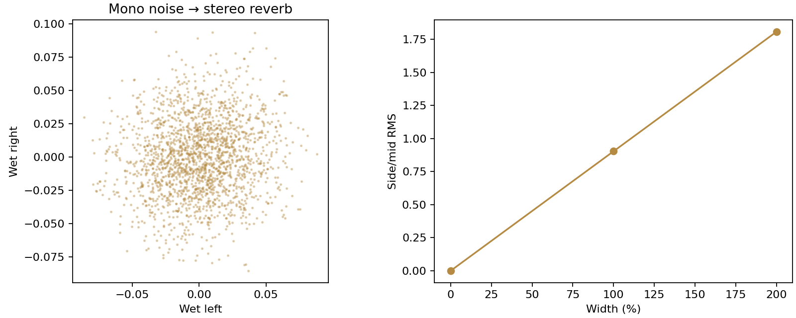

Seeded uniform mono noise (MT19937 seed 72463, amplitude ±0.25) plays for two seconds, followed by a one-second tail. Other controls are defaults, except Auto Off and Mix 100%. Side/mid RMS is measured over 0.5–2.5 s, including the beginning of the tail. Width 0 must be mono; 100% and 200% must produce substantial side energy. The scatter uses every third sample from 0.5–0.625 s at Width 100%. Width is outside the feedback loop and uses normalization to avoid increasing its maximum mid/side gain.

## Tap automation, detector behavior and host integration

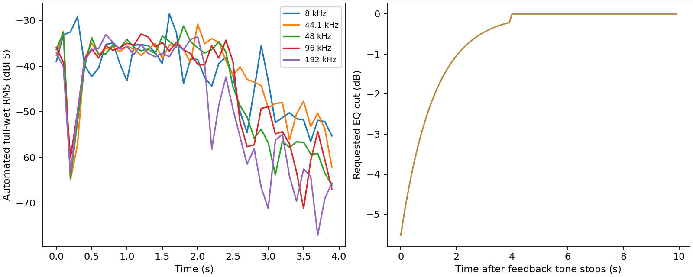

At 8/44.1/48/96/192 kHz, two seconds of mono noise feed a full-wet 40 s-decay engine while Time alternates between 20/500 ms, Tap Shift between −100/+100%, Phase between 0/100%, and Diffusion and Scatter across five settings. New settings arrive every 17 blocks of 128 samples, so their rate varies with sample rate. Four seconds are rendered. Every sample must remain finite and bounded, and the late tail must remain bounded after the source stops. This is a stress test, not proof against every automation schedule.

A separate read-head test changes the requested tap every 31 samples while a 250 ms fade is in progress. It verifies exact DC unity and no abrupt discontinuity on a stationary periodic tone. New requests wait for the current fade endpoint. Spectral tests verify persistence, detection of anti-phase feedback without mid cancellation, protection of a matching input partial, no cuts on seeded broadband noise, and release of held bands during silence. The displayed release curve follows a previously detected tone; it illustrates the approximately 1.2 s release constant, not onset latency.

Host checks cover all twenty parameters and state recall, mono/stereo layouts, zero dry latency, exact dry output at zero Mix and initial host bypass, static DSP invariance at 1/127/512-sample blocks, FFT submission Off/On, analysis staying hot during bypass, and containment of nonfinite input. Native editor checks cover all twelve knob bindings, the two shelf handles (XY drag and double-click reset), the Sync button, note-label display and free/synced Time rebinding, title information, one-sentence hints and 50%–120% bounds.

## Reproduce

From the repository root:

```sh
cmake -S projects/LanReverb -B build/lan -DCMAKE_BUILD_TYPE=Release -DLAN_REVERB_BUILD_TESTS=ON
cmake --build build/lan --target LanReverbTests --parallel 3
xvfb-run -a ./build/lan/LanReverbTests --report /tmp/lan-reverb-report
python3 projects/LanReverb/Tests/generate_report.py /tmp/lan-reverb-report --publish
```

Omit `xvfb-run -a` on a desktop system. Linux GUI previews can additionally use the existing X11-atom helper described in the project README. Python plots require NumPy and Matplotlib. Compressed CSVs preserve raw measurements. No DAW, external processor, hardware reference, or listening panel is part of these tests. AU/macOS and real DAW behavior require platform validation.
