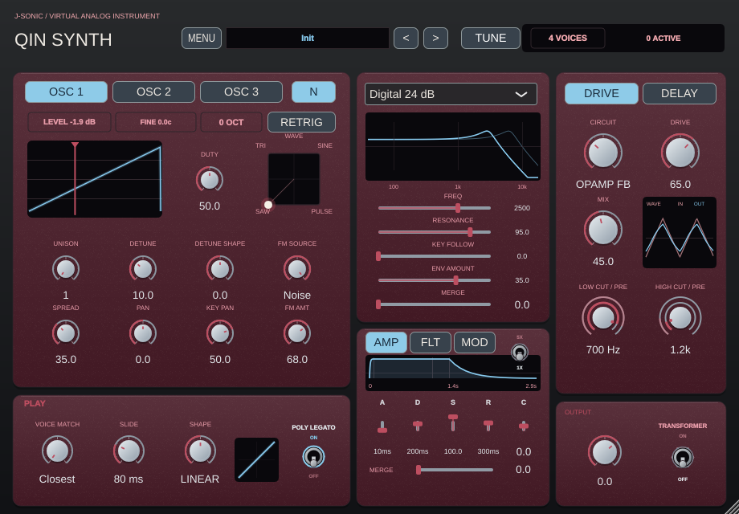
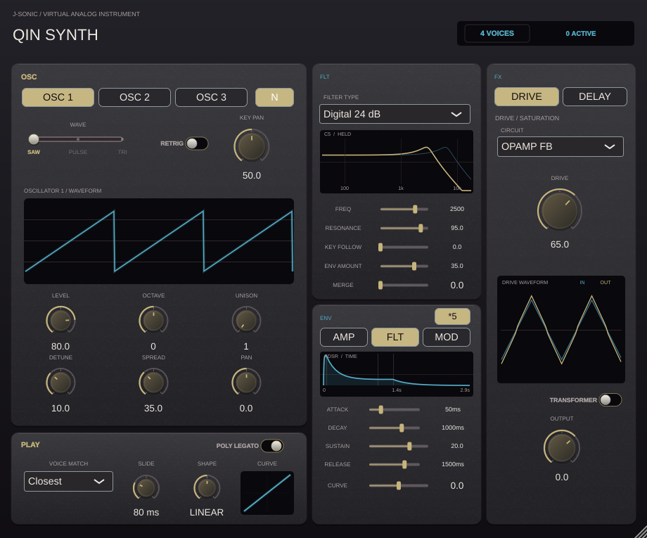
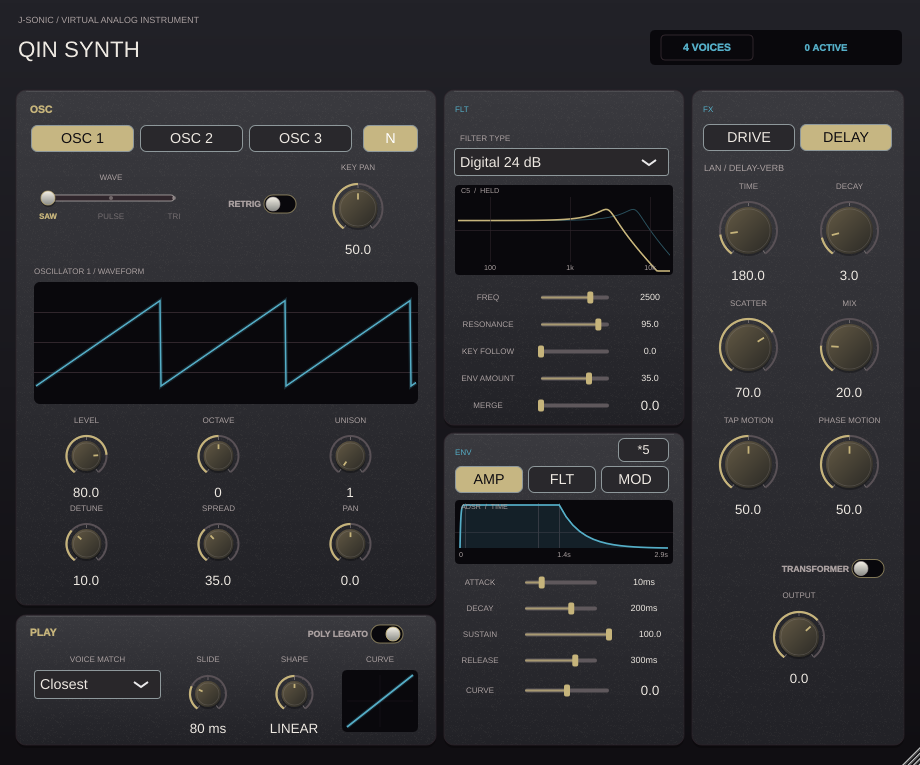
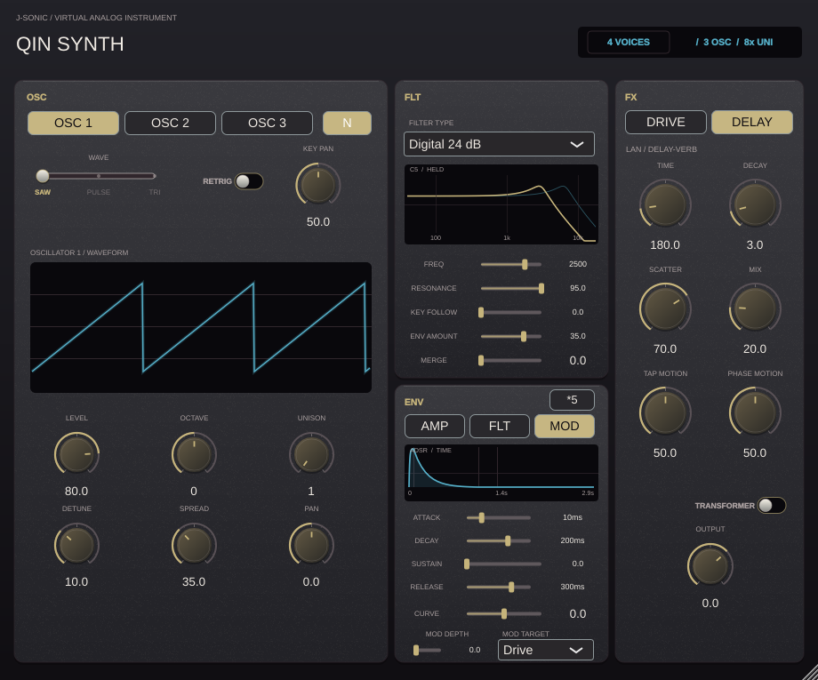
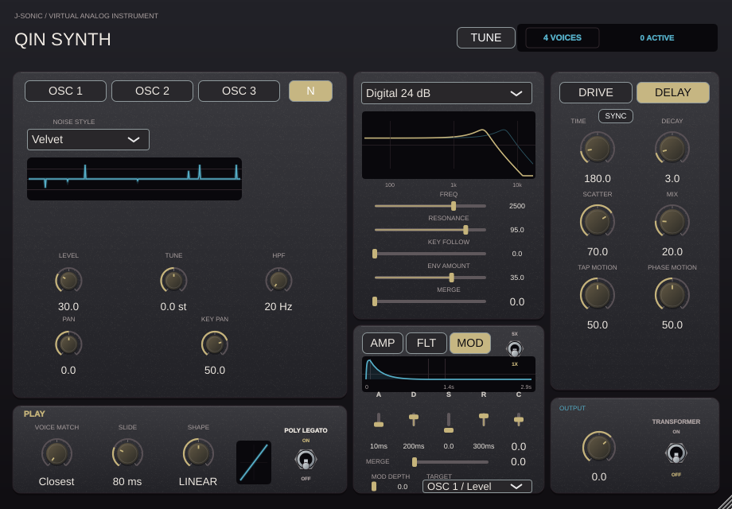

# Qin Synth

Qin Synth is a stereo MIDI instrument with adjustable 1–16-note polyphony, three virtual-analog oscillators per note, and up to eight unison copies per oscillator. It is version 0.7.5 in the J-Sonic suite.











Drag the voice count in the header up or down to set maximum polyphony. At one voice, overlapping notes change the active pitch without restarting its envelopes or oscillators; releasing the current note returns to the most recent key still held. Each OSC panel has a square waveform pad with Saw and Pulse at the bottom corners and Triangle and Sine at the top corners. Drag inside the pad to blend all four waves; movement is smoothed in the audio path, and both pad axes can be automated. The **Retrig** switch restarts every enabled oscillator and unison copy at phase zero on a new voice onset; when off, a reused voice continues from its previous phase.

The header also shows the active voice count, including allocated voices in release. The **PLAY** panel below OSC enables Poly Legato for more than one voice. The stepped **Voice Match** knob chooses **Closest** or **Farthest** by MIDI pitch distance, or **Upwards** or **Downwards** to prefer voices below or above the new note. Directional modes fall back to the closest voice when no voice lies in the requested direction. Released voices are reused before held voices, and releasing a redirected note returns its voice to its most recent still-held pitch. **Slide** sets a 0–2000 ms pitch glide for mono and poly legato. **Shape** fades continuously from logarithmic through linear to an S-shaped sigmoid glide. The small curve display beside Shape previews the selected glide as the knob moves; tuned noise, filter key follow, and key pan follow the moving pitch.

Qin follows the section hierarchy of Spire: a tabbed **OSC** sound module above **PLAY** on the left, **FLT** above **ENV** in the center, and compact tabbed **FX** above a dedicated **OUTPUT** section on the right. OSC, PLAY, FLT, ENV, and OUTPUT stay visible while FX switches between Drive and Delay. Every control remains available to host automation.

Each tonal oscillator blends band-limited saw, pulse, and triangle waves with a sine wave, with Level and Octave beside the waveform pad and unison, detune, stereo spread, and whole-oscillator pan below. **Detune Shape** redistributes the pitches of the inner unison voices: −100% clusters them near the center, 0% spaces them evenly, and +100% clusters them toward the two outer voices. The outer voices stay at the Detune knob's selected limits. The **N** button enables an independent noise oscillator for each active voice and opens its control panel. Noise has its own Level, Pan, semitone Tune, and logarithmic HPF, plus a **White**, **Pink**, or sparse **Velvet** style selector. Tune moves a broad noise resonance with MIDI pitch; HPF removes low frequencies after the tuned filter. Spread positions detuned tonal copies around each oscillator's pan center. Key Pan sits with the lower OSC knobs and ranges from −100% to +100%: positive values pan higher notes right, negative values pan them left, and zero centers pitches.

ENV has three independent envelopes, edited with five vertical sliders labeled A, D, S, R, and C for Attack, Decay, Sustain, Release, and Curve. Negative Curve values bring movement forward, while positive values delay it. The graph uses a labeled time scale and reflects the selected envelope's settings. Attack, Decay, and Release run from 1 to 5000 ms on logarithmic sliders in **AMP**, **FLT**, and **MOD**; FLT Sustain also has finer resolution near zero. The headerless **\*5** switch remains visible on all three tabs and multiplies every envelope's Attack, Decay, and Release by five, extending their effective range to 5–25,000 ms while preserving the underlying settings so they return when the toggle is off. Sustain is unchanged. AMP shapes voice amplitude. FLT shifts the cutoff by up to four octaves in either direction, set by the FLT panel's bipolar Env Amount. MOD can target voice drive or unison spread; its Depth sets the amount. The compact editor is 640 pixels tall at 100% scale.

FLT uses logarithmic Freq and Resonance sliders, plus Key Follow, Env Amount, and Merge. At 0% Merge every note has its own filter; at 100% the voices feed one shared stereo filter, with a smooth blend between the two paths. The response graph has a frequency scale and follows the active cutoff while notes play, averaging the voice cutoffs by level when several notes sound together. When idle, its solid trace represents the held filter-envelope level at C5 and a lighter trace shows the attack peak when different. The graph reserves headroom for the resonant peak. Filter choices are bypass, a nonlinear TB-303-style four-pole ladder, an 18 dB/oct resonant Sallen-Key-style section, and 12 or 24 dB/oct digital state-variable low-passes. The state-variable filter uses a stable trapezoidal integrator with controlled resonance, and a soft ceiling bounds extreme polyphonic output. Cutoff changes glide over 5 ms per voice. New notes take a free voice first, then steal a released or oldest voice when the selected voice count is occupied. Sustain pedal (MIDI CC64), note-off, all-notes-off, and all-sound-off are supported.

The stepped Circuit knob selects Zao Drive's BJT common emitter, op-amp feedback, diode shunt, and series diode crossover models with Zao's default bias and diode knee. Drive sets circuit intensity, while the separate Mix knob blends driven and dry oscillator signals; a short crossfade softens circuit changes. At zero Mix, the drive circuit does no processing. The waveform display compares input and post-drive output in real time, synchronizing both traces to complete input waveform periods when a stable period is present; when idle, it previews the selected circuit driven by a triangle wave. The OSC waveform illustration also spans three complete cycles. The delay-reverb reuses Lan Reverb's eight-line feedback network and Scatter control. Qin disables Lan's spectral resonance analyser and tamer. A MIDI note-on changes the feedback tap target and phase-scatter depth according to note pitch, velocity, and alternating onset direction; Tap Motion and Phase Motion set the amount. Lan's existing tap crossfades and phase smoothing soften these changes. No audio-spectrum detection controls the tap or phase. The **Transformer** button inserts Ren Transformer's default stage after Lan's output. Its nonlinear core stops processing when the button is off; a fixed 64-sample delay keeps the on and off paths aligned.

The FLT Resonance slider uses a logarithmic taper with finer control near 100%, while keeping the same 0–100% filter setting.

The instrument outputs stereo VST3 and Standalone formats on Windows, macOS, and Linux, plus AU on macOS. The shared suite version is defined in `../PluginVersion.cmake`.

Build the native processor tests with:

```bash
cmake -S projects/QinSynth -B build/qin -DCMAKE_BUILD_TYPE=Release
cmake --build build/qin --target QinSynthTests QinSynth_VST3
```

The tests cover MIDI sample offsets, adjustable voice limits and mono legato return, oscillator phase retriggering and phase continuation, three oscillators at eightfold unison, oscillator and key-based stereo placement, tuned White/Pink/Velvet noise with HPF and pan, logarithmic parameter mapping, the three-envelope time multiplier, all filter modes, merged and per-voice filtering, extreme resonance and envelope settings across three sample rates, release, four Zao circuits and their live waveform, waveform period sync from low to high notes, Ren transformer switching, Lan's delay tail, the MIDI-only reverb steering path, and editor tabs and plots.
