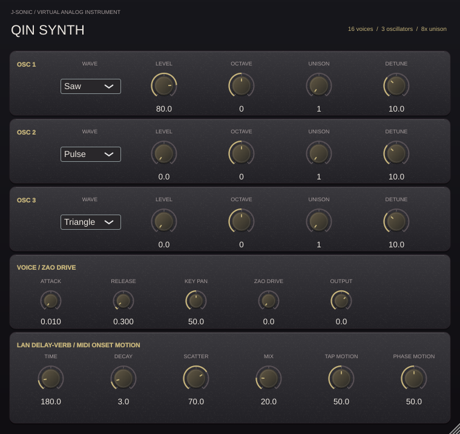

# Qin Synth

Qin Synth is a stereo MIDI instrument with 16-note polyphony, three virtual-analog oscillators per note, and up to eight unison copies per oscillator. It is version 0.7.5 in the J-Sonic suite.



Each oscillator has a band-limited saw, pulse, or triangle waveform, plus level, octave, unison count, and detune controls. Unison copies spread gently across stereo. Key Pan maps lower MIDI notes left and higher notes right, as in a piano-key recording. Attack and Release control the voice amplitude. New notes take a free voice first, then steal a released or oldest voice when all 16 are occupied. Sustain pedal (MIDI CC64), note-off, all-notes-off, and all-sound-off are supported.

The Drive control uses Zao Drive's op-amp feedback clipper circuit. The delay-reverb reuses Lan Reverb's eight-line feedback network and Scatter control. Qin disables Lan's spectral resonance analyser and tamer. A MIDI note-on changes the feedback tap target and phase-scatter depth according to note pitch, velocity, and alternating onset direction; Tap Motion and Phase Motion set the amount. Lan's existing tap crossfades and phase smoothing soften these changes. No audio-spectrum detection controls the tap or phase.

The instrument outputs stereo VST3 and Standalone formats on Windows, macOS, and Linux, plus AU on macOS. The shared suite version is defined in `../PluginVersion.cmake`.

Build the native processor tests with:

```bash
cmake -S projects/QinSynth -B build/qin -DCMAKE_BUILD_TYPE=Release
cmake --build build/qin --target QinSynthTests QinSynth_VST3
```

The tests cover MIDI sample offsets, the 16-voice limit, three oscillators at eightfold unison, key-based stereo panning, release, Zao drive, Lan's delay tail, and the MIDI-only reverb steering path.
