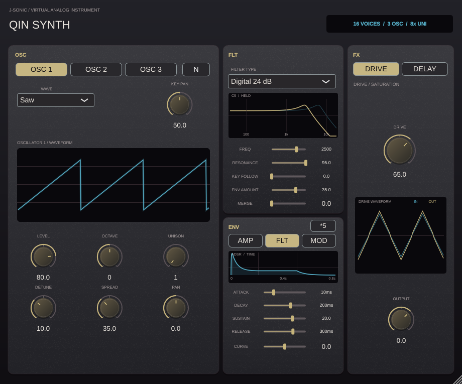
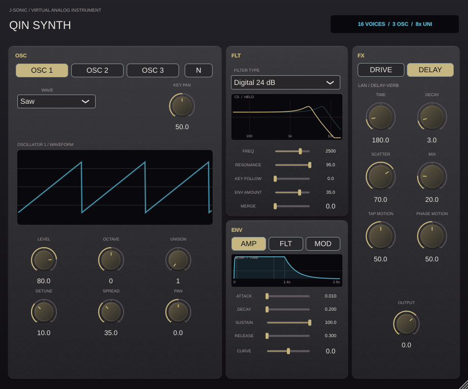
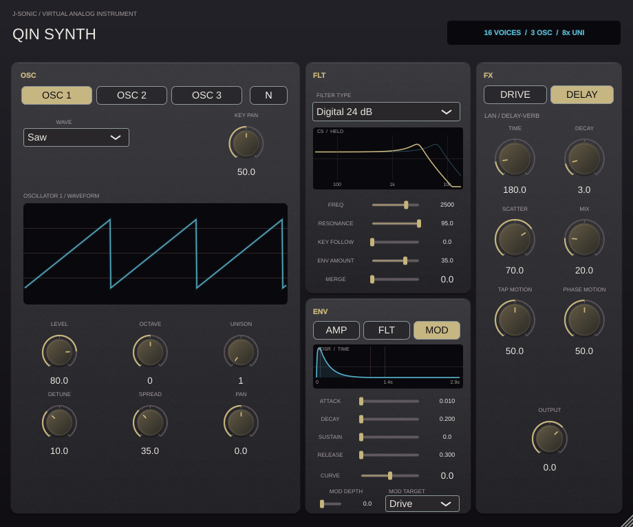

# Qin Synth

Qin Synth is a stereo MIDI instrument with 16-note polyphony, three virtual-analog oscillators per note, and up to eight unison copies per oscillator. It is version 0.7.5 in the J-Sonic suite.








Qin follows the section hierarchy of Spire: a tabbed **OSC** sound module on the left, **FLT** above **ENV** in the center, and tabbed **FX** on the right. OSC, FLT, and ENV stay visible while FX switches between Drive and Delay. Every control remains available to host automation.

Each oscillator has a band-limited saw, pulse, or triangle waveform, with level, octave, unison count, detune, stereo spread, and whole-oscillator pan in the same OSC panel. The **N** button adds an independent noise oscillator to each active voice. Spread positions detuned copies around the oscillator's pan center. Key Pan separately maps lower MIDI notes left and higher notes right, as in a piano-key recording.

ENV has three independent ADSR envelopes, edited with horizontal sliders and an envelope-shape display. Each envelope has a Curve slider: negative values bring its movement forward, while positive values delay it. The graph uses a labeled time scale and reflects the selected envelope's attack, decay, sustain, release, and curve. FLT Attack, Decay, and Release run from 1 to 5000 ms on logarithmic sliders; FLT Sustain also has finer resolution near zero. The **\*5** button multiplies the three filter envelope times by five, capped at 5000 ms, without changing Sustain. AMP shapes voice amplitude. FLT shifts the cutoff by up to four octaves in either direction, set by the FLT panel's bipolar Env Amount. MOD can target voice drive or unison spread; its Depth sets the amount.

FLT uses logarithmic Freq and Resonance sliders, plus Key Follow, Env Amount, and Merge. At 0% Merge every note has its own filter; at 100% the voices feed one shared stereo filter, with a smooth blend between the two paths. The response graph has a frequency scale and follows the active cutoff while notes play, averaging the voice cutoffs by level when several notes sound together. When idle, its solid trace represents the held filter-envelope level at C5 and a lighter trace shows the attack peak when different. The graph reserves headroom for the resonant peak. Filter choices are bypass, a nonlinear TB-303-style four-pole ladder, an 18 dB/oct resonant Sallen-Key-style section, and 12 or 24 dB/oct digital state-variable low-passes. The state-variable filter uses a stable trapezoidal integrator with controlled resonance, and a soft ceiling bounds extreme polyphonic output. Cutoff changes glide over 5 ms per voice. New notes take a free voice first, then steal a released or oldest voice when all 16 are occupied. Sustain pedal (MIDI CC64), note-off, all-notes-off, and all-sound-off are supported.

The Drive control uses Zao Drive's op-amp feedback clipper circuit. Its waveform display compares input and post-drive output in real time; when idle, it previews the same circuit driven by a triangle wave. The delay-reverb reuses Lan Reverb's eight-line feedback network and Scatter control. Qin disables Lan's spectral resonance analyser and tamer. A MIDI note-on changes the feedback tap target and phase-scatter depth according to note pitch, velocity, and alternating onset direction; Tap Motion and Phase Motion set the amount. Lan's existing tap crossfades and phase smoothing soften these changes. No audio-spectrum detection controls the tap or phase.

The instrument outputs stereo VST3 and Standalone formats on Windows, macOS, and Linux, plus AU on macOS. The shared suite version is defined in `../PluginVersion.cmake`.

Build the native processor tests with:

```bash
cmake -S projects/QinSynth -B build/qin -DCMAKE_BUILD_TYPE=Release
cmake --build build/qin --target QinSynthTests QinSynth_VST3
```

The tests cover MIDI sample offsets, the 16-voice limit, three oscillators at eightfold unison, oscillator and key-based stereo placement, the noise oscillator, logarithmic parameter mapping, the filter time multiplier, all filter modes, merged and per-voice filtering, extreme resonance and envelope settings across three sample rates, release, Drive and its live waveform, Lan's delay tail, the MIDI-only reverb steering path, and editor tabs and plots.
