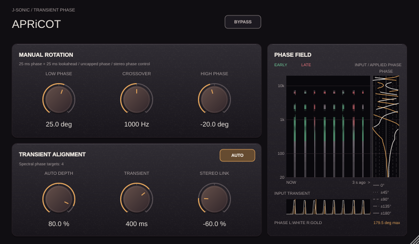

# APRiCOT

APRiCOT is J-SONIC's manual and transient-guided phase rotator. It offers
independent low/high rotation, a smooth adjustable crossover, signed Auto Depth,
Transient release, Stereo Link, and **25 ms correction lookahead** in a
50%–120% scalable editor, with **50 ms total reported latency**.
The 840 × 490 default panel includes a vertical phase-field meter beside the controls.



## Manual rotation and 50 ms total latency

Low Phase and High Phase range from −180° to +180°. Crossover, from 80 Hz to
4 kHz, smoothly blends the two phase settings; at the crossover the requested
angle is their average. Positive angles advance phase relative to the delayed
reference, and negative angles retard it. Both channels share the manual
response; Stereo Link controls their automatic corrections.

A 20 Hz cycle lasts 50 ms, so 180° at 20 Hz corresponds to 25 ms. The phase
FIR retains its 25 ms center and ±25 ms support. A separate input delay gives
the detector **25 ms lookahead before convolution**, so phase targets can settle
before the transient enters the filter. The plugin reports
`round(sampleRate × 0.05)` samples to the host: **2,400 samples at 48 kHz**.
Neutral, Auto Off, and host/plugin bypass all retain that same 50 ms latency.
Host/plugin bypass keeps the selected phase processing and Auto detector hot,
so current correction targets are ready when the wet signal returns. Auto Off
and zero Depth still suspend automatic correction analysis; a visible meter can
request its own display analysis.
The maximum audio tail is approximately 75 ms including lookahead. Rotated
transients can move or spread around the compensated reference; host latency
remains fixed rather than following each frequency's group delay.

On the academic branch the combined manual, Auto and stereo phase request is
**uncapped** and retains complete interpolation turns before FIR synthesis.
Manual knobs retain their ±180° ranges for automation compatibility.

The desired positive-frequency response is unit magnitude with phase
`low × w(f) + high × (1 − w(f))`, where `w(f) = 1 / (1 + (f / crossover)^4)`.
The worker builds a real, conjugate-symmetric FIR and tapers its outer edges.
This finite response approximates an ideal phase-only rotator: magnitude ripple
is measurable, especially near 20 Hz at intermediate angles. DC and Nyquist
must be real; they cannot carry an arbitrary quadrature rotation. See the
[measured report](Tests/Reports/REPORT.md) rather than assuming an exact all-pass.

## Transient alignment

Auto analyzes overlapping input spectrogram frames on a separate worker.
Streaming detection uses log spectral growth at meaningful peaks, a 60 ms
spectral baseline, and an adaptive 64-frame novelty threshold. Comparing
neighbouring previous FFT bins rejects vibrato; local attack evidence and
newly emerging frequencies detect soft hits without a full-window crest veto.
Quiet, masked, and alternating-strength attacks are checked against steady
noise, vibrato, and a slow pad in the [onset accuracy report](Tests/Reports/onset-detection.md).
A 20 ms re-arm interval and short event follow-up avoid duplicate onsets. Local spectral peaks define up to 24 phase-band anchors. Neighboring local
phase/delay curves join with smoothstep interpolation, with angles unwrapped
across ±180°; only the outer edges taper to neutral. Peak selection reserves
coverage across logarithmic regions up to 20 kHz (or 45% of sample rate), then
fills spare slots with the strongest remaining peaks to avoid low-frequency bias. Their complex phase and locally unwrapped phase slopes
estimate how wave packets can meet the new transient's strongest spectral-residual sample. Relative
band-delay targets are limited to ±25 ms. Combined manual, Auto and Stereo
Link phase is passed directly to FIR design without saturation or
principal-angle wrapping on the academic branch.

**Auto Depth** ranges from −100% to +100% and scales only these additional
corrections: 0% leaves the manual response unchanged, +100% applies the full
detected target, and negative values reverse the correction away from alignment.
**Stereo Link** replaces Output and ranges from −100% to +100%:

- **+100%** (default) applies one shared correction to both channels, preserving
  their phase relationship; nearly cancelling mid input uses the left channel
  as the shared analysis reference.
- **0%** detects, corrects, and releases each channel independently, with no
  contribution from the shared target.
- **−100%** keeps independent correction and adds opposing shifts of up to
  2.5 ms per channel at full Depth, without phase clipping,
  aiming to move their transients farther apart; the channel whose detected anchor is earlier moves earlier, and the
  later one moves later (equal anchors use left-earlier/right-later).

Positive intermediate values blend toward the shared correction; negative
values scale the opposing timing request. Achievable peak separation still
depends on the input and finite FIR; maximum negative Link does not guarantee
the largest peak spacing on every signal. Separation follows Transient release
and absolute Auto Depth; at zero Depth or Auto Off it stops. Mono layouts use
independent correction without an opposing shift. The fixed host latency stays
50 ms, and the plugin now has unity output gain. Old Output state is ignored
when loading older sessions, which default to +100% Link.

**Transient** sets the exponential target-strength release from 20 to 1,000 ms
(default 200 ms): 36.8% of target strength remains after one time constant, counted in audio samples
after the protected onset response has passed. New distinct onsets refresh
the correction; it decays
back toward the manual response between hits, and returns fully once below 0.1%.
The uncapped phase request scales with decaying target strength; the measured
principal phase can still wrap at ±180° during release.
Release responses update at up to 50 Hz through the existing 5 ms kernel fades.
Auto Off or Depth 0% stops automatic response updates; a visible meter retains
lower-rate input analysis for manual use, which stops when the editor is hidden.
Auto gathers 5 ms of context, then latches one correction per onset instead
of retuning on each overlapping FFT frame. The target remains fixed through
the lookahead and the entire finite FIR response, plus an 8 ms safety margin;
release starts after this hold. A distinct onset more than 20 ms later can
start a new collection. A response that misses the safe pre-onset handoff
window waits until the protected response has passed; it is no longer discarded
for the entire note. This restores correction eligibility while preserving the
protected attack. A late handoff can still rotate sustained audio, so this does
not guarantee removal of all sustain modulation. Closely spaced/overlapping
transients and worker scheduling limit what this heuristic can align.

The audio thread performs a short SIMD FIR head and a partitioned FFT tail.
The tail starts after the head, adding **no extra block latency**. A three-slot
handoff transfers immutable responses from the worker, and a 5 ms sigmoid
crossfade warms both responses on the same signal history. No kernel design,
heap allocation, or waiting for a worker occurs in the audio callback.
Independent channel FFTs run only below +100% Link or for mono layouts;
+100% reuses the shared filter design. Auto analysis is dormant when Off.

## Phase Field meter

The side panel shows three seconds of input spectrogram history on a logarithmic
frequency axis. **New data enters at the left and moves right** toward older
history. Brighter pixels mean more input energy; **green** marks frequency bands
arriving before the detected transient anchor, and **red** marks those arriving
after it. Colours describe observed input timing, so they also work with Auto Off.
Timing colors interpolate between adjacent detected bands; spectral energy
remains unchanged, so genuine gaps in the input still appear dark.
A small display hold makes short onsets visible without changing the audio detector.

The **white left-channel** and **gold right-channel** curves in the 56 px track
show applied rotation relative to the compensated 50 ms reference, from −180° to +180°
across the track. They are measured from the corresponding active FIR,
including manual rotation, Auto Depth, response crossfades, and bypass;
they do not jump ahead to an unapplied worker target. Guides mark 0°, ±45°,
±90°, ±135°, and the ±180° boundaries, with matching line styles in the key
below the track; positive rotation is right of center and negative is left.
The history is 168 px wide, and the readout reports the largest absolute
rotation. The academic DSP preserves uncapped combined manual, Auto and Stereo
Link requests. The meter measures the finite FIR, whose phase can show
approximation ripple. The display
uses principal phase for that measured complex response. Curves are
clipped to the ±180° track, and smoothing is checked against overshoot.
The lower strip shows input peak activity in white and detected
transient activity in amber.

The meter shares the background spectral analysis. Fixed-size atomic snapshots
transfer input and applied-response data without GUI locks in the audio callback.
No display FFT runs on the audio thread. Rendering and scrolling run at 30 Hz,
with recent spectra held across short missed UI refreshes to avoid gaps in
sustained notes; stale input clears after 200 ms. Held transient colours decay,
and new onsets are never backdated into missed columns.
Closing the editor clears its history; sample-rate changes clear incompatible
frequency history. Audio processing and the fixed latency are unchanged.

Meter startup follows the editor's full parent hierarchy and native peer, so
AU hosts can mark the child editor visible before attaching their host window
without leaving its timers stopped. Parent hide/show and peer reattachment
pause/resume the existing meter; duplicate callbacks do not reset its scroll
clock. A visible timer also checks for native peer removal, which JUCE can
perform without sending a visibility event. The hosted-editor regression
reproduces the AU wrapper attachment order and checks all these transitions;
this is a Linux lifecycle test, not a run inside Logic Pro on macOS.

The [Auto alignment performance report](Tests/Reports/AUTO_ALIGNMENT.md)
includes a live three-hit Auto case, measured phase errors, positive/negative
Depth, lookahead/onset stability, short/long release curves, Stereo Link
comparisons, and matched-level
listening examples.
The phase display rounds the curve with shape-preserving cubic interpolation
and splits at ±180° wraps; Stereo Link sits at the far right beside Transient.

## Build and test

From the repository root:

```bash
cmake -S projects/XuanPhase -B build/xuan -DCMAKE_BUILD_TYPE=Release
cmake --build build/xuan --config Release --target XuanPhase_VST3 XuanPhase_Standalone XuanPhaseTests --parallel 3
ctest --test-dir build/xuan -C Release --output-on-failure
```

On headless Linux, run CTest through `xvfb-run -a` to provide a display for JUCE.

macOS also provides `XuanPhase_AU`; `build-macos-all.sh` discovers this project
automatically. Windows can build `XuanPhase_VST3` with Visual Studio 2022 using
the same configure/build pattern and `--config Release`, or use the manual
[All Plugins - Windows VST3 workflow](../../.github/workflows/all-plugins-windows.yml).
For plugin-only builds set `-DXUAN_PHASE_BUILD_TESTS=OFF`.

Generate measurements and a native preview on Linux:

```bash
xvfb-run -a python3 projects/ZaoDrive/Tests/with_x11_atoms.py build/xuan/XuanPhaseTests --report "$PWD/projects/XuanPhase/Tests/Reports"
xvfb-run -a python3 projects/ZaoDrive/Tests/with_x11_atoms.py \
  build/xuan/XuanPhaseTests --editor "$PWD/projects/XuanPhase/Previews/apricot.png"
python3 projects/XuanPhase/Tests/generate_report.py
```

Run just the AU-style hosted-editor lifecycle regression on Linux:

```bash
xvfb-run -a python3 projects/ZaoDrive/Tests/with_x11_atoms.py \
  build/xuan/XuanPhaseTests --hosted-editor
```

The editor capture uses the existing X11 window-atom helper from Zao Drive's
tests so the preview exercises a real desktop window on a bare Xvfb display.

[Hover hints](TOOLTIPS.md) cover every control. See the repository
[build guide](../../docs/BUILDING.md) for dependencies and installation paths.

## Academic finite-FIR core test

The academic test exports the actual `PhaseEngine::impulse()` coefficients and
production target interpolation for all three synthetic fixtures at 44.1, 48
and 96 kHz. The [three-panel report](Tests/Reports/Academic/fir-core.md) shows:

- **(a)** interpolated target phase on logarithmic frequency with selected peaks
  marked, plus the actual uncapped request;
- **(b)** the synthesized finite kernel, its 25 ms causal centre and ±25 ms
  relative support (2,401 taps at 48 kHz);
- **(c)** requested versus measured phase and magnitude deviation from 0 dB.

Only the declared FIR centre delay is removed when measuring phase. The
separate audio lookahead is excluded from the kernel response. Python checks
the native measurements against a direct DTFT of the exported taps; the native
test also verifies unit-pulse output through the real convolution path. The
report includes raw CSVs, PNG figures, vector PDFs and sampled error metrics.

Run from the repository root:

```sh
python3 projects/run_academic_tests.py --only APRiCOT --output build/academic-results
python3 projects/test_apricot_fir_report.py
python3 projects/generate_academic_reports.py build/academic-results --only APRiCOT --publish
```

## Academic novelty-to-phase handoff figure

The [spectral-novelty handoff report](Tests/Reports/Academic/novelty-phase-handoff.md)
shows soft new attacks under a louder sustained background, the actual positive
spectral novelty and adaptive threshold, the event-context residual anchor,
and the selected phase/delay targets derived from that same anchor. Its PNG and
vector PDF are generated from test-only observations inside the production
`PhaseEngine::analyse()` implementation. The ordinary plugin contains none of
the trace observer. Reproduce with the APRiCOT academic workflow above; run
`python3 projects/test_apricot_novelty_report.py` for known-signal calibration.
