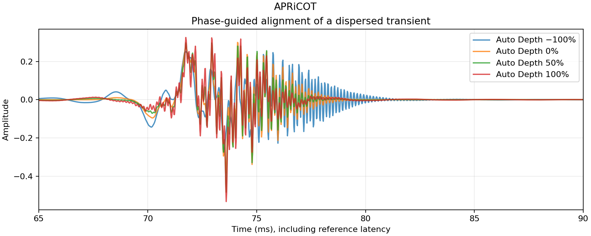
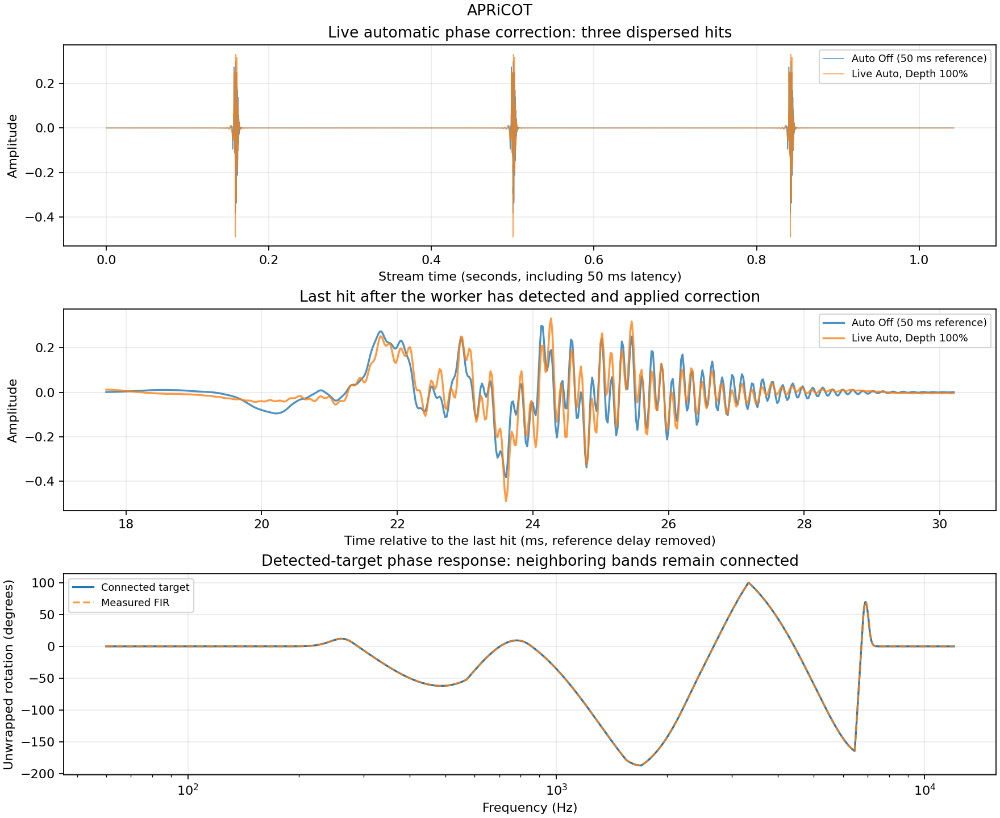
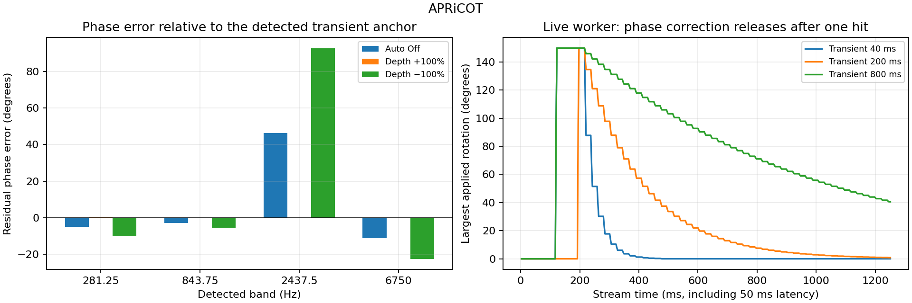
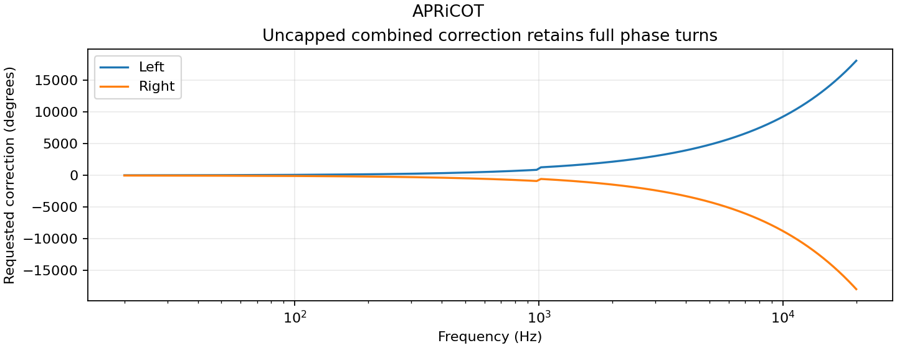
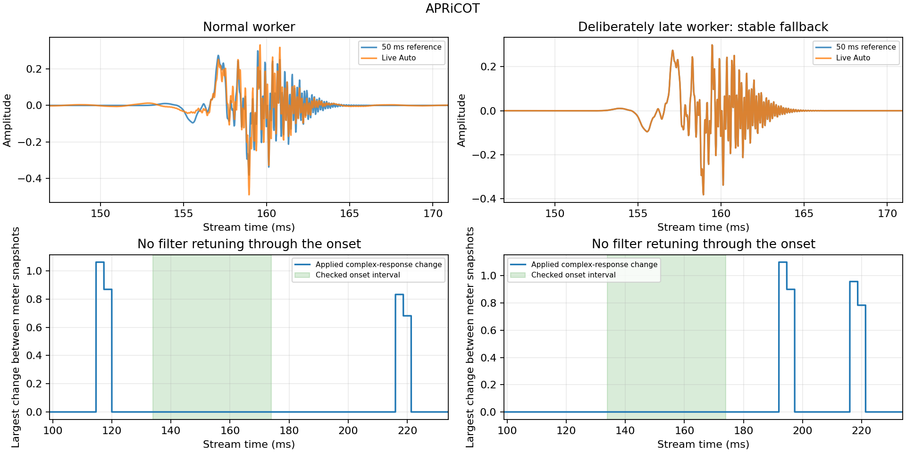
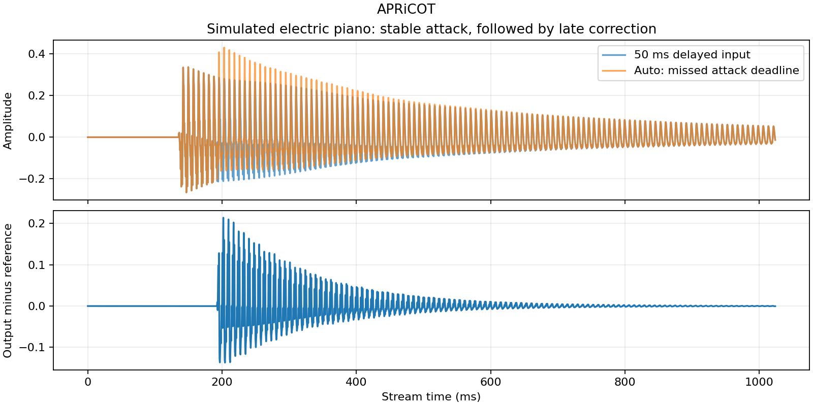
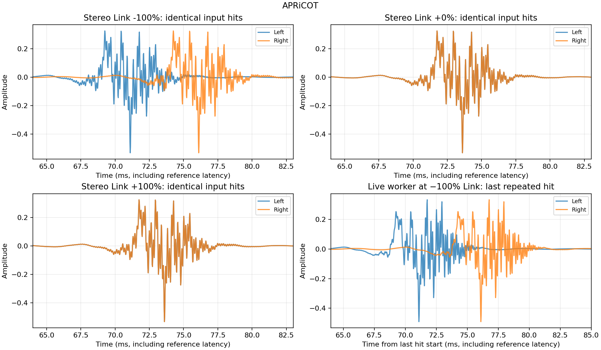

# APRiCOT automatic alignment performance

Measured at 48 kHz using the production FIR, convolution engine, and analysis worker.
Run `XuanPhaseTests --report <this directory>` then `python3 ../generate_report.py` to reproduce.

## Transient spectral phase and Depth

Four Gaussian wave packets at 281.25, 843.75, 2437.5 and 6750 Hz have staggered
centres. Their measured spectrogram phases and slopes generate narrow-band
targets. The actual audio convolution then runs at Depth −100/0/50/100%.
This deterministic test freezes the detected target before rendering, separating
the phase algorithm's effect from real-time worker scheduling. The reference
delay is included in every trace. No output gain or loudness normalization is
applied; both RMS and crest are reported to expose magnitude changes.

| Auto Depth | Peak | RMS over the full 7,000-sample buffer | Crest factor |
| --- | ---: | ---: | ---: |
| −100% | 0.272990 | 0.028242 | 19.705 dB |
| 0% | 0.382388 | 0.028242 | 22.632 dB |
| 50% | 0.483089 | 0.028242 | 24.663 dB |
| 100% | 0.532231 | 0.028242 | 25.504 dB |

Depth 0 is sample-identical to manual-only processing. Full Depth must improve
the dispersed hit's peak by at least 5% in this test. Detected group-delay
corrections are bounded to ±25 ms; stationary noise must not repeatedly trigger
new targets. A separate streamed three-hit test exercises the real worker,
response handoff and stereo linking; host bypass is checked with nonzero
rotation and negative Stereo Link. Peak improvement on this constructed signal is not a guarantee
for arbitrary recordings. Native editor checks cover parameter binding, hover
hints and the 50%–120% resize limits.

## Live automatic phase-shifting case

This additional case feeds three repeated dispersed hits into the **real processor
and analysis worker** at 48 kHz in 128-sample blocks, starting with no detected
targets. Auto is On at 100% Depth with the default 200 ms Transient release;
Low Phase and High Phase are zero, gain is unity, and Stereo Link is +100%.
The block loop gives the background worker 3 ms per block; scheduling can affect
the first hit. Auto Off is the identical input delayed by the fixed 50 ms.
No target is preloaded, and no gain compensation or normalization is applied.

| Hit | Auto Off peak | Live Auto peak | Peak increase | RMS change |
| --- | ---: | ---: | ---: | ---: |
| 1 | 0.382388 | 0.490522 | 28.3% | -0.0000 dB |
| 2 | 0.382388 | 0.490522 | 28.3% | -0.0000 dB |
| 3 | 0.382388 | 0.490522 | 28.3% | -0.0000 dB |

Each RMS window spans 4,096 samples including the complete hit and response tail.
Tests require the last hit's peak to improve by at least 5% while RMS stays within
2% of the reference. This demonstrates automatic phase shifting on a deliberately
dispersed signal; arbitrary source material may improve less or lose peak level.
Listen at the same playback level: [Auto Off](auto-off.wav), [Live Auto](auto-on.wav).

The response subplot measures the deterministic detected-target FIR used in the
Depth test above, rather than pretending a time-varying stream has one fixed
transfer function. Adjacent targets now interpolate their local phase/delay
curves with a smoothstep blend instead of fading to zero between Gaussian peaks.
Angles unwrap before interpolation across +/-180 degrees; only the outside edges
taper to neutral. Regression checks cover gaps, wrapped angles, continuity at
every detected target, and connected timing colors. Spectrogram energy still
shows real spectral gaps, since absent input frequencies must remain dark.

A separate broadband-onset regression contains over 24 spectral peaks and
requires the 24 selected targets to include both sub-1 kHz and above-16 kHz
content. Selection reserves the strongest peak in each logarithmic region,
then fills remaining slots by strength, rather than taking the first 24
low-frequency peaks. Coverage now extends to 20 kHz (limited to 45% of the
sample rate).

## Alignment accuracy, reverse Depth, and Transient release

At each detected spectral peak, residual error is the measured FIR rotation
minus the required rotation toward the common transient anchor, wrapped to
±180°. This directly measures phase alignment in addition to comparing peaks.
The deterministic response is frozen at full correction to isolate the alignment
objective from worker timing and release. Intermediate frequencies follow the
connected curve; this table measures the four detected peaks only. Corrections
are no longer clipped at ±150°; remaining error comes from the finite response and estimator.

| Auto Depth | Mean absolute residual error | Largest absolute residual error |
| --- | ---: | ---: |
| Off | 16.348° | 46.406° |
| +100% | 0.048° | 0.189° |
| −100% | 32.743° | 92.812° |

Negative Depth reverses the correction: on this constructed hit it doubles the
phase error and reduces the peak, while positive Depth moves the detected bands
toward the shared anchor. RMS remains approximately equal. This is a creative
reverse-alignment control, not a guarantee of lower peak for every input.

The release plot uses a separate **live-worker** single-hit stream, with Depth
−100% to also verify that negative settings activate analysis. It measures the
actual applied FIR response through audio telemetry, including kernel handoffs
and crossfades, at Transient 40/200/800 ms. Time follows processed audio samples,
so offline rendering speed does not change the envelope. Release is exponential:
after one selected time constant, 36.8% of the underlying target strength remains; after
about seven time constants, the response returns to manual-only processing.
The uncapped requested rotation scales continuously with target strength;
the principal-phase meter can still wrap at ±180° as that request releases.
The release starts after the protected onset hold (lookahead + complete FIR
response + 8 ms safety margin), rather than the first sample of the hit. Rebuilds occur at up to 50 Hz during release and use the
existing 5 ms response crossfade; the plotted envelope includes that stepping.

| Transient | Largest applied rotation during test | Rotation at end of 1.25 s stream |
| --- | ---: | ---: |
| 40 ms | 149.858° | 0.000000° |
| 200 ms | 149.858° | 0.804683° |
| 800 ms | 149.858° | 40.566300° |

The short release must return below 1°; the long release must retain more
correction than the medium release. Other checks cover zero Depth, host bypass,
linked stereo, fixed latency, state recall of all eight parameters, 24-band
coverage into the high frequencies, and no repeated triggers on stationary noise.

These are reproducible synthetic cases, not a listening benchmark for all music.
The method prioritizes a detected transient anchor; conflicting components,
polyphonic material, low-frequency resolution, finite-FIR magnitude ripple,
and worker scheduling can limit improvement. Higher peak at unchanged RMS is a
punch indicator, not proof of perceived quality or reconstruction of an original
undispersed source.

## Uncapped phase request

The academic branch passes the complete combined manual, automatic and Stereo
Link phase directly to FIR design, without the former ±150° saturation or
principal-angle wrapping. Manual knobs retain their ±180° ranges; automatic
interpolation and opposing time shifts can contribute additional phase turns.

The regression checks the analytical sum over 20 Hz–20 kHz, manual
−180/0/+180°, Auto Depth −100/0/+100%, Stereo Link
−100/−50/0/+50/+100% and both channels. It explicitly verifies requests beyond
both +180° and −180°. The displayed curves retain every turn; the audio target
is `exp(j*phase)`, and the meter still shows the principal measured phase.
Finite-support approximation error is measured separately from request range.
Data: [phase-range.csv](phase-range.csv).

## Lookahead and onset stability

The input now has 25 ms of actual delay **before** phase convolution, while
analysis continues to see the raw input. Together with the 25 ms FIR center,
reported host latency is 50 ms at every setting, including bypass and Auto Off.
The entire finite response can extend to approximately 75 ms after input.

Auto gathers 5 ms of context and latches the detected target once per onset.
Repeated detections from overlapping FFT frames do not repeatedly redesign it.
Target strength holds through the lookahead and full FIR response plus an
8 ms safety margin; Transient release starts after that hold. An onset more
than 20 ms later can begin a new collection. Responses arriving too late for
the pre-onset 5 ms crossfade wait until the protected response has passed.
The whole-note discard rule has been reverted; late detections remain eligible.

The test streams a dispersed hit through the real worker with Transient at
its fastest 20 ms setting. It records changes to the actual applied complex
FIR response, and requires it to stay fixed through an interval containing
the delayed transient peak. A second run deliberately pauses the worker until
its safe pre-onset deadline has passed: the hit must retain the previous,
neutral response during the protected onset, then recover its correction afterward.
No audio callback waits for the worker.

| Worker | Largest filter change in checked onset interval |
| --- | ---: |
| Normal | 0.00000000 |
| Late | 0.00000000 |

The zero changes demonstrate removal of kernel modulation in this constructed
onset interval; static phase rotation can still reshape or ring on a transient.
A late hit may receive less attack correction, followed by phase rotation of its sustain.
Closely spaced transients, manual automation, and arbitrary recordings are not
promised to match this isolated synthetic case. Additional checks cover exact
50 ms neutral/bypass latency at 8/44.1/48/96/192 kHz, the entire reported tail,
and safe transition boundaries at each rate.
Data: [lookahead.csv](lookahead.csv).

A second fixture uses a simulated C3 electric-piano note with a 2 ms hammer
attack, nine decaying harmonics, an inharmonic bell partial, and a long sustain.
With a deliberately late worker, it must generate spectral targets, keep its
applied response fixed through the protected attack, and apply a correction
later. The waveform difference after the attack is expected phase processing;
this regression no longer requires the whole sustained note to remain dry.
Late correction can still modulate sustained material. These tests protect the
onset and restore eligibility; they do not promise to remove every piano warble.
Data: [electric-piano.csv](electric-piano.csv).

## Stereo Link: shared, independent, and separating correction

Stereo Link replaces Output; processing gain is unity. The first three plots
feed identical dispersed hits to both channels through the actual convolution
engine at 100% Auto Depth, using a frozen detected target. At +100%, both
channels receive exactly the same correction; at 0%, each uses its own target
(which happens to be identical in this example). At negative values, opposing
transient-guided timing shifts aim to separate the channels. The opposing
request reaches 2.5 ms per channel at full Depth without phase clipping.
The measured peak spacing still depends on the input, estimated correction
and finite FIR response; this table reports actual rendered samples.

| Stereo Link | Absolute channel peak spacing | L/R correlation over complete buffer |
| --- | ---: | ---: |
| -100% | 5.000 ms | -0.0033 |
| -50% | 2.500 ms | 0.2426 |
| +0% | 0.000 ms | 1.0000 |
| +50% | 0.000 ms | 1.0000 |
| +100% | 0.000 ms | 1.0000 |

A separate regression uses a right-channel hit shifted by 80 samples. At 0%,
its output must equal its own independently analyzed and convolved reference,
and changing the shared target must not affect either output. At +100%, the
measured channel filters must be identical even when their individual targets
differ. A live test also pairs a left transient with a steady right sine: at
0% the right correction stays neutral, while at +100% both channels receive
the same correction. Intermediate positive values blend toward the shared
phase response.

The final subplot runs the real background worker at −100% Link on repeated
identical hits with the default 200 ms release, starting with no preloaded
target. It verifies that independent analysis and response handoff actually
apply differing uncapped channel corrections; release,
scheduling, and the finite FIR determine the resulting peak spacing. Listen: [live stereo separation](stereo-link-live.wav).

Mono input layouts disable the opposing shift. Auto Off and zero Auto Depth
also disable separation. Channel kernels crossfade together, retain block-size
invariance, and the white/gold traces are checked against independent DFTs of
the corresponding FIR. Negative Link deliberately changes the stereo phase
relationship and may change the mono sum; it is a widening effect rather than
a promise of maximum separation for every transient source.

Data: [transient](transient.csv), [live audio](auto-live.csv), [phase targets](auto-targets.csv), [release](auto-release.csv).
