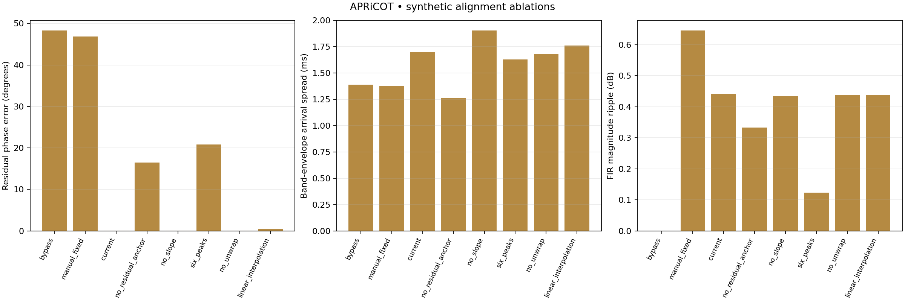
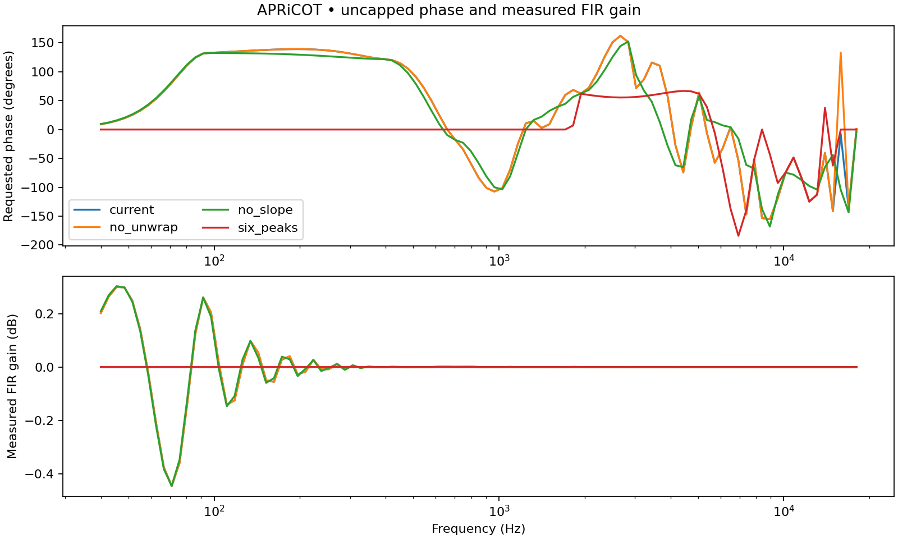
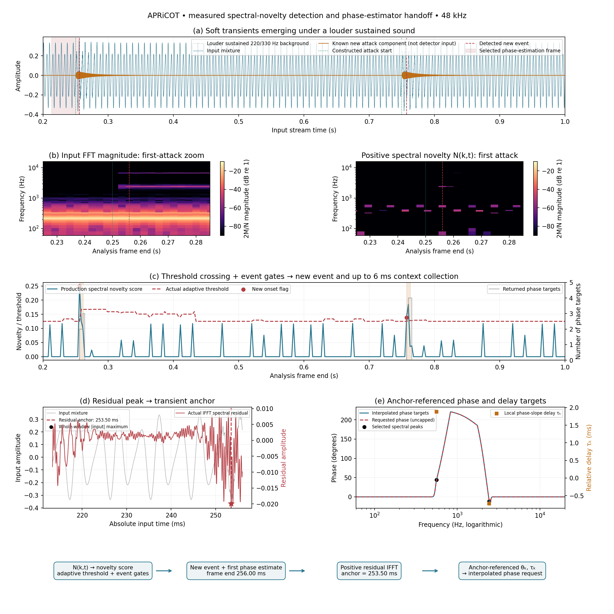
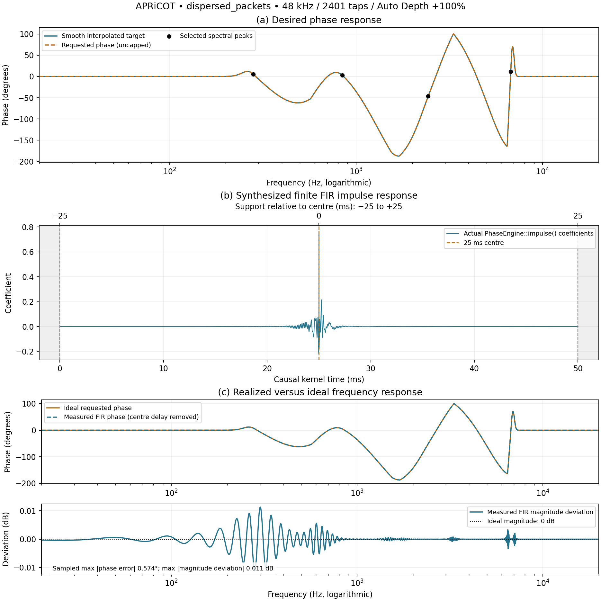
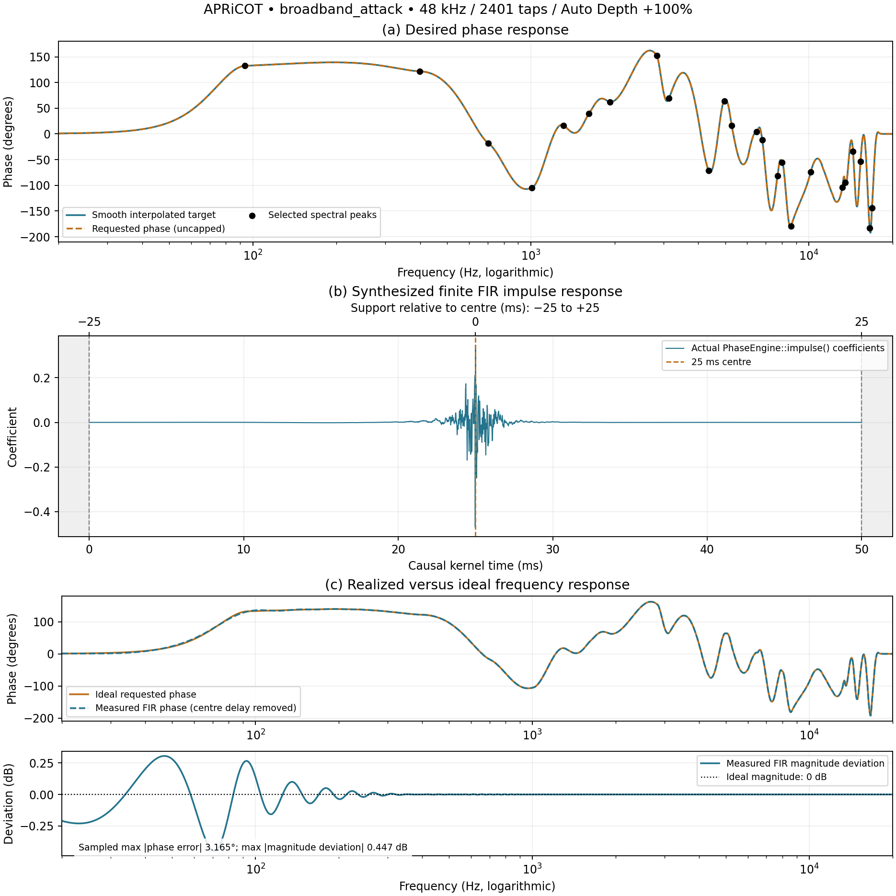
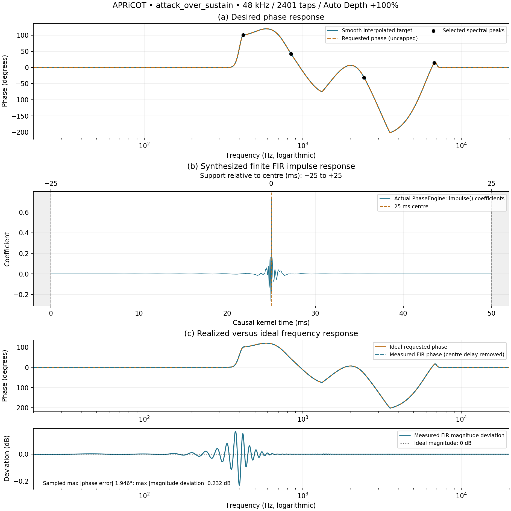
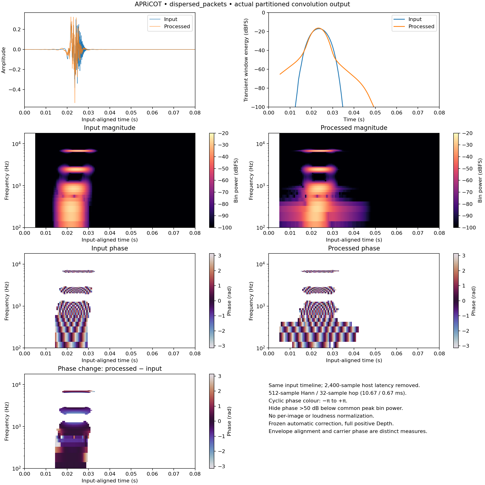
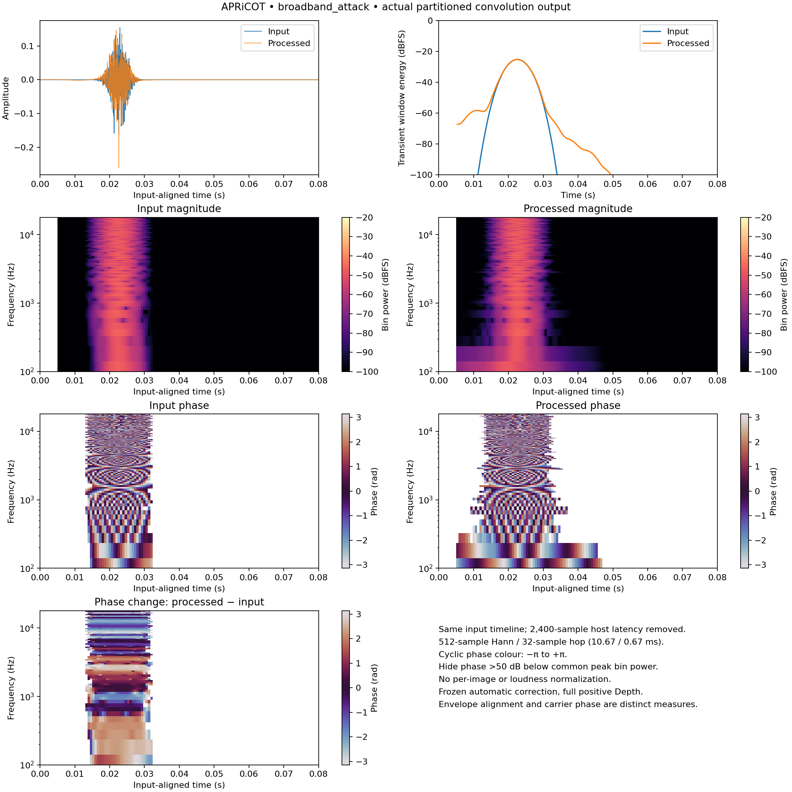
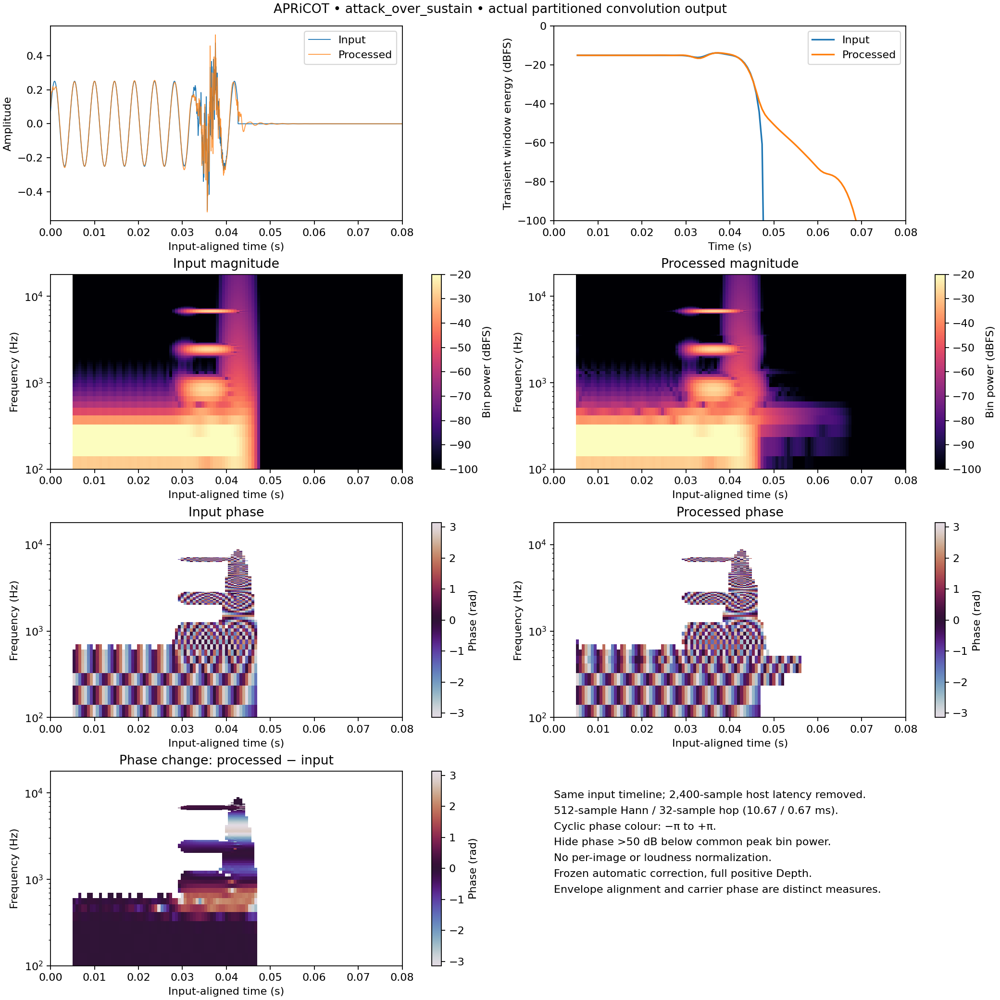

# APRiCOT: synthetic alignment ablations

72 signal/variant conditions at 44.1/48/96 kHz, including the production finite FIR and partitioned audio convolution.



| Variant | Phase error ° | Arrival spread ms | Ripple dB | Crest dB |
|---|---:|---:|---:|---:|
| bypass | 48.3460 | 1.3881 | 0.0000 | 21.2981 |
| manual_fixed | 46.8574 | 1.3777 | 0.6464 | 21.7604 |
| current | 0.0690 | 1.6985 | 0.4404 | 23.8010 |
| no_residual_anchor | 16.4960 | 1.2622 | 0.3336 | 24.3267 |
| no_slope | 0.0343 | 1.9050 | 0.4351 | 23.3222 |
| six_peaks | 20.8691 | 1.6269 | 0.1233 | 22.1544 |
| no_unwrap | 0.0691 | 1.6781 | 0.4390 | 23.7049 |
| linear_interpolation | 0.5015 | 1.7614 | 0.4372 | 23.7591 |

These averages are descriptive and combine very different fixtures. In particular, phase-target accuracy and envelope arrival spread need not improve together.



## Spectral novelty → detected transient → phase estimator



[Vector PDF](novelty-phase-handoff.pdf)

This deterministic streamed fixture uses the **production `PhaseEngine::analyse()`** at 48 kHz, 2,048-sample frames and 128-sample hops. Two soft two-partial attacks (2,437.5/6,750 Hz, amplitude coefficient 0.035, 1.5 ms rise, 22 ms decay) emerge over a louder stationary 220/330 Hz background (amplitudes 0.25/0.10). The first 200 ms warm the detector. Ground-truth attack starts are fixture labels, not detector inputs.

| Constructed attack start (ms) | Detector frame end (ms) | Detection delay (ms) |
|---|---|---|
| 250.00 | 256.00 | 6.00 |
| 750.00 | 757.33 | 7.33 |

**(a–b)** show the original mixture and newly emerging spectral content; the heatmaps zoom to the first attack (225–285 ms), while the waveform and detector trace show both events. At each bin, the observed positive residual magnitude is `N=max(0, M−1.25*max(previous neighbour magnitudes)−0.5*floor)` when `M>0.01*largest`, otherwise zero. The figure exports this intermediate value from the real detector. Both heatmaps share the same scale, `20 log10(2*magnitude/2048)`, without separate gain normalization. The FFT uses production's short edge tapers, not a substitute Hann analysis. Spectral images are timestamped at the **end** of the analysis window.

**(c)** shows the actual novelty score and adaptive threshold. The threshold is the maximum of 0.125, median+4×max(0.003,MAD), and mean+3.5×standard deviation over the current history. A threshold crossing alone is insufficient: production energy/attack/emergence, release and 20 ms re-arm gates also apply. Red dots are the actual new-onset flags. Orange spans show the up-to-6 ms event-context collection; gray steps count targets actually returned to the phase estimator. Follow-up frames can return targets without flagging another onset.

**(d)** selects the first detected-event frame at **256.000 ms**. Production preserves the current complex FFT phase, replaces magnitudes with the event's accumulated positive novelty, imposes conjugate symmetry, and takes the IFFT. Its largest absolute real sample becomes the transient anchor at **253.500 ms**, rather than automatically using the mixture's whole-window peak. The residual has its own labeled amplitude axis; it is not secretly gain-matched to the louder input.

**(e)** uses that **same exported anchor and FFT** to show selected targets and the resulting interpolation. For FFT peak bin k and frame-relative anchor a, production computes `θₖ=wrap(sign(anchor)−2π*k*a/N−arg(Xₖ))` (sign term π for a negative anchor, 0 otherwise) and `τₖ=clip(−wrap(arg(Xₖ₊₁)−arg(Xₖ₋₁)+4π*a/N)/(4π*fs/N), ±25 ms)`. Those targets enter the actual smooth interpolation and uncapped phase request at full positive Auto Depth. This is a measured connection between detection and phase estimation, not a schematic arrow attached to independently synthesized targets.

The first returned targets are retained exactly, including peaks that differ from the known synthesized attack partials:

| Selected frequency (Hz) | Anchor-referenced θₖ (degrees) | Local τₖ (ms) |
|---|---:|---:|
| 562.50 | 43.839 | 1.879 |
| 2437.50 | -11.404 | -0.728 |

Selected 562.5 Hz is outside one FFT bin of either constructed attack partial (2,437.5/6,750 Hz). A successful onset flag therefore does not guarantee perfect separation of the new attack or selection of every intended partial.

### Follow-up context: observed anchor drift

The figure selects the **first new-event frame by rule**, not the best-looking later frame. The complete trace also retains the estimator's following context frames:

| Frame end (ms) | Absolute anchor (ms) | Returned targets | Anchor at/after the new attack start? |
|---|---|---:|---|
| 256.000 | 253.500 | 2 | yes |
| 258.667 | 257.792 | 2 | yes |
| 261.333 | 218.958 | 3 | no |

On this fixture a later context frame relocates the residual anchor into the earlier sustained background. Detection of the new attack therefore does not guarantee that every subsequent phase estimate stays anchored to it. This unfavorable outcome is preserved. The plot is an initial-handoff demonstration, not proof of robust separation or uniformly correct phase estimation.

The observer compiles **only into the academic executable**. Native tests require exactly two post-warmup detections, both within 30 ms, no phase targets outside event/context frames, and an anchor belonging to the new attack at the actual residual peak. Python independently reconstructs positive novelty, the residual IFFT, and the anchor-referenced phase/delay targets from exported windowed samples and compares them with native results. This synchronous chronological analysis experiment excludes worker scheduling, kernel handoff deadlines and audio-output latency; it does not establish detector accuracy on recordings or listeners.

Raw data: `novelty-audio.csv.gz`, `novelty-frames.csv.gz`, `novelty-spectrum.csv.gz`, `novelty-context.csv.gz`, `novelty-peaks.csv.gz` and `novelty-target-curve.csv.gz`.


## Finite FIR core: requested, synthesized and realized



[Vector PDF](fir-core-dispersed_packets.pdf)



[Vector PDF](fir-core-broadband_attack.pdf)



[Vector PDF](fir-core-attack_over_sustain.pdf)

Panel **(a)** evaluates the production `bandValue()` smooth interpolation densely on logarithmic frequency, with the detected spectral peaks marked at their connected/interpolated target angles. The actual `phaseAt()` request is uncapped and follows that interpolated target at full positive Auto Depth with zero manual rotation. The original principal target angles are preserved in `fir-peaks.csv.gz`; interpolation uses connected angles and local phase-slope terms, so its curve can retain extra phase turns. No Python interpolation substitutes for the production implementation.

Panel **(b)** plots every actual coefficient returned by `PhaseEngine::impulse()`. At 48 kHz there are **2,401 taps**, indexed 0–2,400, with a **25 ms causal centre** and **−25 ms to +25 ms relative support** (0–50 ms causal time). Gray areas lie outside the finite support. These coefficients include the production taper and are not normalized or replaced by an ideal impulse. The separate input lookahead is not part of this kernel. At other sample rates, `centre = juce::roundToInt(0.025*fs)` and length is `2*centre+1`; at 44.1 kHz the centre/support radius in this run is 24.988662 ms due to sample rounding. The plotter derives the centre from the exported odd kernel length rather than imposing a rounding convention.

Panel **(c)** compares the ideal request with a direct DTFT of those same coefficients: `Hc(f)=sum_n h[n]*exp(−j*2π*f*(n−centre)/fs)`. Only the declared FIR centre delay is removed; there is no fitted delay, phase offset, gain correction or loudness matching. Measured phase is displayed on the branch nearest the requested phase. Phase error is the wrapped difference `arg(Hc*exp(−j*requested))`; magnitude deviation is `20*log10(abs(Hc))`, relative to the ideal **0 dB**. Both favorable and unfavorable approximation errors remain visible.

All three synthetic fixtures are checked at **44.1/48/96 kHz**. The figures show 48 kHz; `fir-approximation-metrics.csv` retains all nine conditions. Each response uses 2,049 log-spaced frequencies from 20 Hz to min(20 kHz, 0.49×fs), plus every exact selected-peak frequency. The maxima/RMSE describe this frequency grid, not a continuous-frequency error bound. `fir-response.csv.gz` stores native interpolated/requested phase and measured complex response; `fir-kernels.csv.gz` stores all actual taps and both time coordinates.

Native tests verify finite taps, exact support length and tapered boundaries, the neutral unit impulse at the declared centre, and reproduction of each kernel by the actual partitioned-convolution audio path driven by a unit pulse (including the correctly rounded separate lookahead). The report independently recomputes the dense DTFT from the exported taps and checks complex response, phase error, magnitude deviation and exact peak/curve correspondence. These figures establish the finite-FIR approximation; they do not impose an unsupported universal error tolerance or claim better perceived transients.


## Protocol and metrics

Fixtures are four Gaussian wave packets with staggered centers, a broadband attack with more than 24 spectral peaks, and the dispersed attack emerging over a stationary 220 Hz sustain. The source specifies every frequency, envelope and phase. Analysis length is the next power of two ≥40 ms, matching production. Eighty identical background-only snapshots settle the spectral novelty history before an otherwise identical snapshot adds the attack. This **paired-snapshot experiment** isolates estimation/anchoring; it is not a streamed detector precision/recall trial. For the sustain case the new attack is deliberately near the frame edge, where the detector can see it. No synthetic event labels are presented as manually annotated musical audio.

Baselines are latency-matched bypass and a fixed manual +45° low/−45° high response at 1 kHz crossover. Auto is full positive Depth, unity strength, default Stereo Link +100%; manual rotation is zero for all adaptive variants. The same analysed event is frozen before rendering, excluding worker scheduling and release from this experiment. Ablations remove residual anchoring, set local phase-slope delay estimates to zero, retain only the six strongest selected peaks (restoring ascending frequency order), disable adjacent-angle unwrapping, or replace smoothstep interpolation with linear interpolation. The combined phase request is **uncapped in every condition** on the academic branch; complete interpolation turns are passed to FIR synthesis. No output gain or RMS normalization is applied.

Phase error is mean absolute wrapped residual between the **measured FIR** phase (25 ms FIR reference removed) and the *full method's original target angles at its detected frequencies*. The common reference avoids rewarding reduced-peak variants by evaluating only their own retained targets. FIR magnitude ripple is max−min gain across 97 logarithmic points from 40 Hz to min(18 kHz, 0.4×sample rate); this is sampled ripple, not a continuous-frequency bound. Audio rendering includes the separate 25 ms lookahead and the full 50 ms host latency.

Arrival spread is the population standard deviation of energy-centroid arrival times in analytic Gaussian frequency bands centered on those same full-method peaks, using bandwidth sigma=max(70 Hz, 0.06×frequency). Each centroid uses the complete zero-padded rendered buffer; positive-frequency FFT bins form an analytic envelope. It is an envelope-centroid metric, not onset timing precision or perceived punch. RMS and crest use that entire common buffer. `pre_window_energy` integrates before 15 ms relative to the 50 ms-delayed input reference, and `tail_energy` after 33 ms; sustained background is included in both, so these columns must not be interpreted as pure processing artifacts.

## Uncapped phase synthesis

The academic branch no longer clips combined manual, Auto or Stereo Link phase at ±150°. The connected interpolated request is passed directly to the complex target `exp(j*phase)`; no principal-angle wrapping or replacement bound is inserted. The sampled FIR phase error remains a circular error, while plots place realized phase on the branch nearest the full requested curve. Updated measurements retain all approximation errors and do not assume removing the cap guarantees improved transient concentration.

A separate exact seam probe demonstrates why unwrapping exists: adjacent +179°/−179° targets yield π at the midpoint with unwrapping and zero without it. Another off-center probe confirms linear and smooth interpolation differ. Tests assert these mechanisms, finite audio, requests beyond the former limit, bounded timing, detected targets, residual-anchor differences, nonzero slope contributions and the six-peak budget. They do not demand universal peak or concentration improvement.

## Limits

These are deterministic synthetic frozen-response measurements. The experiment does not measure live crossfade artifacts, release, stereo decorrelation, detector precision/recall on recordings, or worker starvation. Bypass/manual/adaptive results use the same output length but no perceptual loudness matching. Existing streamed engineering tests remain separate. A finite FIR is not an exact all-pass; the measured ripple is reported rather than assumed absent.


## Rendered transients and phase spectrograms







The three existing 48 kHz fixtures are rendered through the actual finite-FIR/partitioned-convolution path with the analysed event frozen, Auto on, Depth +100%, manual rotation zero and Stereo Link +100%. Remove exactly the declared 50 ms host latency from the output, not an estimated best alignment. A separately rendered neutral reference must match the padded input to 1e−5. The output tail remains available in the raw CSV; plots zoom to the first 80 ms. No event-specific time shift or amplitude scaling is applied.

Phase is the wrapped complex **audio STFT phase**, not the requested filter response or the editor meter. Before and after use identical windows and time origins. Each phase map masks bins more than 50 dB below the shared maximum; the difference is `arg(Y*conj(X))`, shown only where both signals pass that threshold. Waveforms, magnitude maps and window energy show how transient structure changes alongside carrier phase. Narrow low-frequency packets need the longer-window response/arrival metrics elsewhere in this report; these short-window images prioritize transient time resolution. Changed phase does not itself prove sharper transients: unfavorable results remain visible. The frozen render does not test live detector scheduling or correction release.

All spectrograms derive from native sample captures, using NumPy FFTs and Hann windows without boundary padding. One-sided per-bin power is `|FFT(x*w)|²/(N*sum(w²))`, doubling interior bins; its sum is the window-weighted mean square (0 dBFS = mean square 1). Kuo uses 2,048/256 samples (window/hop), Zao 4,096/256, APRiCOT 512/32, all at 48 kHz. Phase is masked in silence. Raw captures are gzip-compressed beside this report.

## Reproduce

From the repository root, run:

```sh
python3 projects/run_academic_tests.py --output build/academic-results
python3 projects/generate_academic_reports.py build/academic-results --publish
```

CMake 3.22+, a C++17 compiler and the normal JUCE system dependencies are required. Plot generation additionally needs Python `numpy` and `matplotlib`. Native tests and CTest do not require Python plotting packages. Detailed CSV files are gzip-compressed alongside this report; `provenance.json` records source hashes and build information when run through the launcher. Timing values are machine-dependent.
