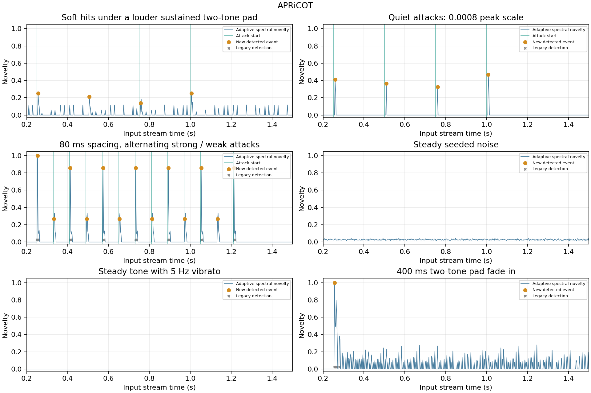

# APRiCOT adaptive onset detection

The recent whole-note discard rule has been reverted. It affected correction
eligibility, rather than changing the detector's thresholds: a detected event
could be dropped when its filter missed the safe pre-onset handoff. Late
responses now wait until the protected response has passed, as before.

The detector itself now distinguishes newly arriving spectral peaks from a
louder sustained background. These streamed tests detect **21/21** constructed
attacks, versus **7/21** for the prior full-window crest rule.



| Case | Attack starts | Legacy matches | Adaptive matches | Adaptive events after warmup | Mean detection delay (ms) |
| --- | ---: | ---: | ---: | ---: | ---: |
| masked | 4 | 0 | 4 | 4 | 6.33 |
| quiet | 4 | 0 | 4 | 4 | 9.00 |
| rapid | 13 | 7 | 13 | 13 | 3.33 |
| noise | 0 | 0 | 0 | 0 | — |
| vibrato | 0 | 0 | 0 | 0 | — |
| slow-pad | 0 | 0 | 0 | 1 | — |

The matching window is 30 ms and the warmup is 200 ms. The pad has no sharp
attack; one event at the start of its fade-in is allowed, with no repeated
triggers during the fade or sustain. Steady noise and vibrato must not trigger.
Quiet and masked fixtures each contain four attacks; the rapid fixture has
13 attacks at 80 ms spacing, alternating amplitudes 0.15 and 0.035. Attack
packets contain 2,437.5/6,750 Hz components, a 1.5 ms rise and 22 ms decay.
The masked case adds a substantially louder sustained 220/330 Hz background.

## Detector changes

- Score log growth at significant local spectral peaks, with a neighbouring-bin
  maximum over the preceding spectrum to reject vibrato and moving leakage.
- Compare against a 60 ms per-bin spectral baseline to identify newly emerging
  content, even when overall crest and energy are dominated by a sustained note.
- Adapt the novelty threshold using 64 frames of background statistics; bound
  large outliers so a strong hit does not hide the following weaker hit.
- Retain local attack evidence for 12 ms and re-arm after a release or clear
  new spectral content, with a minimum 20 ms between new events.
- Keep six milliseconds of follow-up phase analysis per event for the existing
  five-millisecond target collection; do not count follow-up frames as new events.
- Locate the phase anchor in the positive spectral residual, rather than using
  an older, louder waveform peak from the same long FFT window.

The streaming energy floor is approximately −90 dBFS RMS, versus the former
−70 dBFS full-frame gate. Cold-start single-frame reference analysis retains
the original crest rule; the adaptive state takes over on subsequent frames.

## Correction and safety checks

The full DSP/editor suite passes 308,491 checks; Linux VST3 and Standalone
builds pass without warnings.

The 25 ms lookahead, 50 ms reported host latency, ±150° target cap, protected
onset interval, Transient release knob, and five-millisecond sigmoid handoff
remain. Tests verify that late responses are applied after the protected
attack rather than discarded, including a simulated electric-piano sustain.
A late correction can still rotate sustained audio; restoring eligibility
does not guarantee removal of all phase modulation or warble.

These synthetic tests measure detector recall and false triggers separately
from worker scheduling and audible punch. They do not guarantee recognition
of every transient in arbitrary recordings. Frozen single-frame phase-design
probes elsewhere in the report isolate the phase algorithm from adaptive
onset decisions.

Data: [onset-accuracy.csv](onset-accuracy.csv).

Reproduce from the configured test build:

```bash
XuanPhaseTests --onset-report projects/XuanPhase/Tests/Reports
# Full DSP measurements, including the late-worker and piano regressions:
XuanPhaseTests --report projects/XuanPhase/Tests/Reports
python3 projects/XuanPhase/Tests/generate_onset_report.py
python3 projects/XuanPhase/Tests/generate_report.py
```
