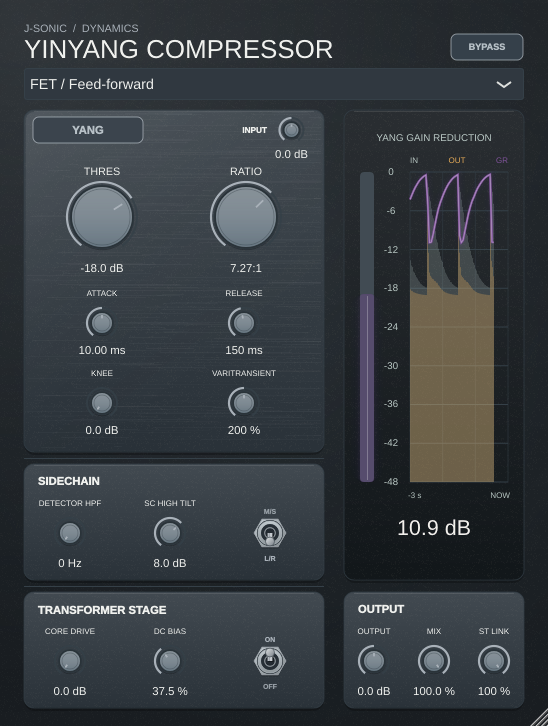

# Yinyang Compressor

A first working compressor plug-in with selectable **feed-forward FET**,
**feedback VCA**, **variable-mu**, and **optical** behavior, plus an optional
output transformer stage. Built with JUCE and C++17.

The entire signal path runs at **4× the host sample rate**, including the
sidechain, detector envelopes, control ramps, compression, M/S processing,
wet/dry mix, output gain, and optional transformer. A single polyphase FIR
converter surrounds this path; the transformer uses its core directly rather
than adding another conversion stage. [Oversampling measurements](Tests/Reports/oversampling.md)
compare folded harmonics with the same compressor equations running at 1×.

These are behavioral models, not measured recreations of particular hardware.
The transformer adds flux-dependent saturation. Its generated distortion is
isolated as a nonlinear residual, filtered by a **500 Hz second-order Butterworth
low-pass (12 dB/octave)**, and added back to the clean signal. This preserves clean
high frequencies while reducing harmonics above 500 Hz; the cutoff is gradual.
The combined signal then passes through a causal loaded
transformer response: a 20 Hz second-order high-pass (Q 1.0) models
low-frequency phase lead and droop, while a 19 kHz second-order low-pass
(Q 1.2) models high-frequency phase lag and resonance from leakage inductance
and winding capacitance. These are provisional design values. The transformer runs at fixed
4× the host sample rate inside the whole-path 257-tap FIR converter. This is
intended to reduce aliasing; strong drive can still produce residual aliases. It
is a prototype for listening and refinement, not a release claimed to match
analog hardware.

## Controls and signal path

4× upsampling → input gain / stereo-linked compressor → wet/dry mix → output
gain → optional transformer → downsampling → output. Bypass returns the original input delayed by the same 64 samples as the
processing path, with a short transition to avoid switching clicks. The mix's dry branch is the original input before
input gain. Output gain and transformer affect both branches of the mix.

The internal detector branch is input gain → detector HPF → optional High Tilt
→ rectification/stereo linking → compression control. High Tilt affects all
four models through this branch; it does not EQ the audio output.

- **FET:** fast peak feed-forward control. Attack time is scaled to one quarter
  of the common attack setting; release is scaled to 70%.
- **VCA:** peak feedback control, sensing the compressed signal before output
  gain. Compensated control slope gives the selected steady-state ratio.
- **Variable-mu:** RMS feedback, progressively increasing ratio, and recovery
  that slows as gain reduction increases. Ratio is a maximum, not a fixed slope.
- **Optical:** RMS feed-forward control with a slow recovery memory in addition
  to the main envelope. Attack is twice the common attack setting.
- **Upward:** optional global dynamics mode. Audio at and above Threshold gets
  0 dB of compressor gain; levels below Threshold are boosted toward it. The
  Ratio control determines the below-threshold slope (for example, 4:1 raises
  a signal 3 dB for each 4 dB it falls below threshold). The Knee smooths the
  transition, and Attack/Release control the gain envelope.
- **VariTransient:** scales attack and release according to current downward
  gain reduction. It is inactive through 3 dB GR, then ramps smoothly across a
  3 dB knee to full effect at 6 dB GR. At 400%, attack can reach 4× its set
  time while release can fall to ¼; 0% leaves both times unchanged. It is
  inactive in Upward mode and defaults to 0%.
- **Detector HPF:** filters only the compression detector. Set to 0 Hz to disable.
- **Transformer drive:** increases saturation without increasing small-signal
  gain. Generated distortion rolls off above 500 Hz. The existing 0–18 dB
  drive range and 6 dB default are retained. Output gain can drive the transformer harder as well.
- **Even harmonics:** optional transformer DC magnetizing current, off at 0% by
  default. Increasing it biases the core response and adds asymmetric
  distortion and even-order harmonics. It is independently automatable and
  saved with the session.
- **SC High Tilt:** sidechain high-shelf amount from 0 to 12 dB, off by default.
  The shelf midpoint is 1.5 kHz; at 12 dB, the midpoint is +6 dB and the high
  frequencies reach +12 dB. It follows the detector HPF and changes compression
  sensitivity only, with no direct output EQ. Older sessions with the previous
  switch enabled migrate to 6 dB, preserving its former +3 dB midpoint / +6 dB
  high-frequency shelf. The old host parameter remains for session compatibility.

Only the selected compressor model runs at steady settings. Outgoing models
run through the existing 20 ms exponential switching fade, then sleep when its
remaining weight falls below -80 dB (about 185 ms). A newly selected model starts
from the dominant audible detector's envelope rather than stale history. The
transformer simulation also stops when Off. Continuous
gain controls and toggle transitions are smoothed over approximately 20 ms.
Mono and stereo layouts are supported, with no lookahead and a fixed
64-sample latency (1.33 ms at 48 kHz), reported to the host for compensation.
The transformer, clean output, and bypass paths retain this latency even when
the transformer is disabled. Both resampling filters have 257 taps. At zero Mix,
the dry signal still passes through these linear-phase filters; host/plugin
bypass returns an exact latency-aligned original input while keeping the full
wet path hot. Attack, release and control smoothing retain their times in
milliseconds at the higher internal rate. Inactive models and the disabled
transformer core still stop processing, but the shared converter remains active.
Host automation and session state recall cover all 20 parameters. Existing
parameter IDs/order are retained; High Tilt, Upward, Stereo Link, Mid/Side,
Even harmonics, VariTransient, and SC High Tilt are appended. AU version hints
2, 3, 4, 5, and 6 mark the compatible additions. There is no external
sidechain, oversampling selector,
automatic makeup gain, or preset browser yet.

The 548 × 726 editor places Threshold, Knee, and Ratio in that order, with
Upward in the Compressor section and VariTransient between Attack and Release.
It resizes from 50% to 120% with a fixed aspect ratio.
Knee and VariTransient use smaller knobs. Yin caps gain at 12 dB and limits
Ratio to 1:1–2:1; Yang retains its 1:1–20:1 range. The host ratio changes in
0.01 increments and retains one 1:1–20:1 position across mode changes;
Yin displays and uses that position on a 1:1–2:1 scale, so Yin 2:1 maps to
Yang 20:1 without rewriting the host's ratio parameter. Older saved Yin states
are migrated to preserve their audible ratio. Yin internally swaps the Attack
and Release time values while keeping their labels and automation controls
unchanged. The shortened
right-hand meter shows upward gain on a -6 to +12 dB scale in Yin, and 0–18 dB
gain reduction in Yang, alongside a scrolling three-second history. Output,
Mix, and Stereo Link sit directly below it. Bypass is a button beside the
plug-in name. Sidechain combines Detector HPF, SC High Tilt, and Mid/Side.
Transformer enable, Core Drive, and DC Bias share a Transformer Stage section.
The compact analog switches show ON/OFF or M/S/L/R at either end of the lever.
The history line runs oldest at left to current at right. **Click the trace to
show the waveform overlay**, then click again to hide it. The
waveform view overlays the uncompressed input in pale grey and the actual
plugin output in gold as semi-transparent, one-sided peak envelopes behind
the GR trace. The overlay expands the shared dB axis to **0 to −48 dB** in
Yang, keeping quieter waveform detail visible. Yin retains +12 dB of headroom
above zero while also extending down to −48 dB. Waveform peaks and the gain
history stay aligned on that expanded axis; hiding the overlay restores the
original gain-only range. The envelopes fold positive and negative peaks into one
magnitude, with no mirrored lower half. It includes Mix, Output and
the optional transformer in the output trace. The original input is delayed by
64 samples for visual alignment with the output. Signed min/max buckets at
approximately 200 Hz preserve short transients and anti-phase stereo without
mid-channel cancellation; the view covers the same three seconds and expires
when audio stops. The GR history, gain bar and dB readout remain visible with the overlay on.
The display choice is retained when reopening the editor on the same instance.



[Waveform display validation](Tests/Reports/waveform-history.md).
The display samples gain reduction at 30 Hz while the editor is open; timestamps
keep the window at three seconds even if UI updates are delayed. Closing the
editor clears its gain-history trace. Transformer, Upward, and Mid/Side use
vertical animated switches; Bypass is an animated button. All retain keyboard
access and host automation. Each model has
its own palette: FET charcoal with purple GR, VCA white Yang panels and white
Yin knobs with white GR,
Variable-mu light green with white GR, and Optical white with red GR. Upward
switches between Yin (upward compression) and Yang (normal compression), resets
the trace, and labels the meter accordingly. The palette follows model automation
and session recall.

## Measured characteristics

See [the measurement report](Measurements/README.md) for current compression
curves, attack/recovery plots, VariTransient envelope measurements,
upward-compression curves, and transformer
harmonic, frequency-response, and phase measurements. Figures are available as
PNG, SVG, and PDF. Original 1× alias measurements remain preserved under
`Measurements/baseline/` for comparison.

The [square-wave phase verification](Measurements/phase/README.md) records
focused measurements for the current 4× transformer. Its 257-tap filters keep
the reported round-trip latency at 64 host samples.

The [output-stage measurements](Measurements/output_stage/README.md) use the
current 500 Hz / 12 dB-per-octave residual filter and 4× transformer path.
They verify transformer harmonic roll-off and High Tilt at 44.1, 48, and
96 kHz. At −12 dBFS peak and 6 dB drive, THD measures 0.7114% at 100 Hz,
0.04205% at 500 Hz, and 0.01101% at 1 kHz. The detector shelf measures
+3.00 dB at 1.5 kHz and +6.00 dB at 10 kHz. At ratio 1:1, toggling High Tilt
leaves output sample-identical with the transformer on or off; with compression
active it increases HF gain reduction in all four models.

The user confirmed that the preceding VST3 and AU builds work on their Mac.
The current 4× transformer and Even harmonics control still need a macOS rebuild
and listening check.

## Build and test in this cloud workspace

From the JUCE repository root:

```bash
. /workspace/juce-env/activate.sh
cmake -S projects/YinyangCompressor -B /workspace/juce-env/yinyang-build \
    -G Ninja -DCMAKE_BUILD_TYPE=Debug
cmake --build /workspace/juce-env/yinyang-build \
    --target YinyangCompressor_VST3 YinyangCompressorDSPTests YinyangCompressorTests YinyangCompressorUpwardCompressionTests --parallel 4
ctest --test-dir /workspace/juce-env/yinyang-build --output-on-failure
```

The optional native editor check needs a display. In this workspace:

```bash
mkdir -p /workspace/juce-env/cache
XDG_CACHE_HOME=/workspace/juce-env/cache xvfb-run -a \
    /workspace/juce-env/yinyang-build/YinyangCompressorTests --editor
```

The editor check also exercises switch clicks, automation, history expiry, waveform toggling, and scaled waveform hit targets. Waveform tests verify transient peaks, stereo anti-phase capture, ring wrapping, elapsed-time expiry, 64-sample input alignment, actual output attenuation, and bit-identical audio with the observer enabled.
It runs the message loop for six seconds with a synthetic GR signal to verify
the animated display. Add an absolute PNG path after `--editor` to save a preview.
Preview PNGs for all four models and their Upward reversals are in
[`Previews`](Previews); the current images include the Even harmonics and
VariTransient controls. To regenerate them after activating the local build
environment, run from the repository root:

```bash
xvfb-run -a /workspace/juce-env/yinyang-build/YinyangCompressorTests \
    --preview-modes "$PWD/projects/YinyangCompressor/Previews"
```

Linux artifact:
`/workspace/juce-env/yinyang-build/YinyangCompressor_artefacts/Debug/VST3/Yinyang Compressor.vst3`.
Linux VST3 binaries cannot load in Logic on macOS.

## Download a Windows VST3 using GitHub Actions

You can build Windows x64 binaries from a Mac using GitHub's hosted runner.
The workflow is [Yinyang Compressor and Shun De-Esser - Windows VST3](../../.github/workflows/yinyang-shun-windows.yml).

1. Open the repository's **Actions** tab. If GitHub has disabled workflows in
   this fork, enable Actions first.
2. Open **Yinyang Compressor and Shun De-Esser - Windows VST3** and select the latest successful
   run for `feature/character-compressor` (or `master` after merging).
3. Under **Artifacts**, download **YinyangCompressor-Windows-x64-VST3**.
4. Extract the ZIP and keep the complete `Yinyang Compressor.vst3` folder.
   On Windows, copy it to `C:\Program Files\Common Files\VST3\`, then rescan
   plug-ins in the Windows DAW. This binary is for Windows x64 hosts.

The workflow automatically starts when this workflow file or plug-in source/
CMake configuration is pushed to either branch. Once the workflow exists on
the repository's default branch, you can also use **Run workflow**, choose
the branch, and click **Run workflow**. Before that, use a push or the latest
run's **Re-run all jobs** button.

It builds only the Release VST3 with Visual Studio 2022; it does not run the
test suites. The MSVC runtime is linked statically. Downloads are retained for
30 days, after which a fresh workflow run is needed. A successful cloud build
does not replace loading/listening checks in a Windows host.

## Build VST3 and AU for the current Apple Silicon Mac

Use a current compatible Xcode installation and CMake 3.22 or newer. From the
JUCE repository root, use a separate build directory from any Intel build:

```bash
cmake -S projects/YinyangCompressor -B build-yinyang-arm64 -G Xcode \
    -DCMAKE_OSX_ARCHITECTURES=arm64 -DCMAKE_OSX_DEPLOYMENT_TARGET=11.0 \
    -DYINYANG_COMPRESSOR_BUILD_TESTS=OFF
cmake --build build-yinyang-arm64 --config Release \
    --target YinyangCompressor_VST3 YinyangCompressor_AU --parallel 4
```

Bundles appear in `build-yinyang-arm64/YinyangCompressor_artefacts/Release/`
under `VST3/Yinyang Compressor.vst3` and `AU/Yinyang Compressor.component`.
Replace your installed copies with these complete bundles and restart the host.
DawDreamer requires an absolute bundle path and matching Python/plug-in architecture.
Logic loads the AU. These commands build without running tests.

## Build an Intel Audio Unit for Catalina / Logic Pro X 10.5.7

Use a Mac with Xcode command-line tools and CMake 3.22 or newer. On Catalina,
use an Xcode version supported by both the OS and JUCE (the checkout documents
Xcode 12.4 as its minimum). A newer build Mac can also target Catalina; verify
the resulting binary on the actual target Mac. The macOS path is provided but
cannot be tested from this Linux workspace.

From the JUCE repository root, with this project present:

```bash
cmake -S projects/YinyangCompressor -B build-yinyang-mac -G Xcode \
    -DCMAKE_OSX_ARCHITECTURES=x86_64 -DCMAKE_OSX_DEPLOYMENT_TARGET=10.15
cmake --build build-yinyang-mac --config Release \
    --target YinyangCompressor_AU
```

The AU is at:
`build-yinyang-mac/YinyangCompressor_artefacts/Release/AU/Yinyang Compressor.component`.
To install a new development build in your user plug-in folder:

```bash
mkdir -p "$HOME/Library/Audio/Plug-Ins/Components"
ditto "build-yinyang-mac/YinyangCompressor_artefacts/Release/AU/Yinyang Compressor.component" \
    "$HOME/Library/Audio/Plug-Ins/Components/Yinyang Compressor.component"
auval -v aufx Chc1 Chra
```

Restart Logic and check Plug-in Manager. Add **Audio FX → Audio Units →
J-SONIC → Yinyang Compressor** to a mono or stereo audio track.
Start with low monitor levels, transformer off, output at 0 dB, and adjust
threshold while watching gain reduction. Confirm bypass, all four models,
transformer, automation, session save/reopen, and mono/stereo playback.

If building this folder separately, provide the JUCE checkout with
`-DJUCE_SOURCE_DIR=/path/to/JUCE`. The project and build targets are named
`YinyangCompressor`; the host-visible product is **Yinyang Compressor**.
Its bundle ID is `audio.jsonic.yinyangcompressor` and its state root is
`YinyangCompressorState`. The old Character Compressor identity and state root
are no longer used. Manufacturer `Chra` and plug-in code `Chc1` identify the
AU type shown in the validation command above.

## Development records and licensing

See [DEVELOPMENT_LOG.md](DEVELOPMENT_LOG.md) for requirements, decisions, actual
validation results, and remaining work. JUCE modules are licensed under AGPLv3
or commercial terms. A commercial JUCE licence may be required for distribution;
see the repository's [LICENSE.md](../../LICENSE.md).
