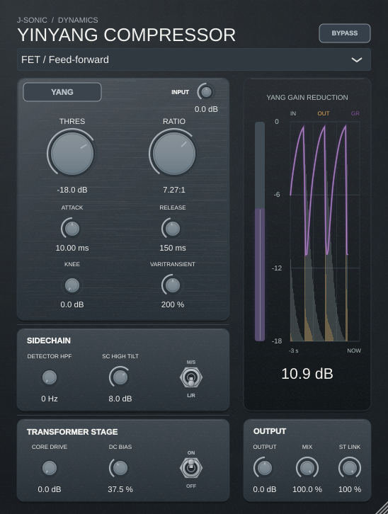

# Clickable waveform history

Version 0.5.0 · 2026-11-04 · Linux x86_64 / GCC 14.2 / Debug.



Click the history plot to show or hide waveform peaks behind the GR trace. Pale grey shows the original input and gold shows
the actual plugin output, including Mix, Output and the transformer when enabled.
Both form one-sided, semi-transparent envelopes (22% input and 30% output
opacity), with the GR history drawn last. Their logarithmic peak positions
share the meter's signed gain axis: 0/−6/−12/−18 dB in Yang overlay mode,
+12/+6/0/−6 dB in Yin. A −6 dBFS peak aligns with the −6 dB label; quieter
levels below the axis are clipped. There is no mirrored lower half. The input reference follows the existing
64-sample dry delay, aligning it with the oversampled output. The gain bar and
numeric gain readout remain available.

The audio thread reduces signed stereo extrema into approximately 200 buckets
per second, retaining individual transients and anti-phase material. An atomic
ring transfers those buckets to the editor without locks or audio-buffer copies.
The editor aggregates them by pixel over three seconds of monotonic time.

Validation passed:

- VST3 and Standalone native builds.
- 3,542 processor/editor assertions, including actual mouse down/up toggling,
  50%/120% hit targets, single-sample stereo peaks, ring wrapping and expiry,
  64-sample alignment, actual attenuation, and identical audio with/without
  the waveform observer. Added mapping checks cover −6/−12 dBFS, full scale,
  silence and negative-only peaks; a native image check verifies the GR trace
  survives the overlay while waveform pixels remain visible and translucent. Assertion counts include existing integration checks.
- The preceding DSP, upward-compression and oversampling suites passed 3/3;
  this update changes only display scaling and drawing.

The preview uses a pulsed 220 Hz signal processed by the actual processor at
the visible control settings. Stereo extrema are combined for the display;
this is a waveform-envelope history rather than a sample-level oscilloscope.

To reproduce the editor checks after building `YinyangCompressorTests`:

```sh
xvfb-run -a python3 projects/ZaoDrive/Tests/with_x11_atoms.py \
  build/yinyang/YinyangCompressorTests --editor \
  "$PWD/projects/YinyangCompressor/Previews/yinyang-waveform.png" --waveform
```
