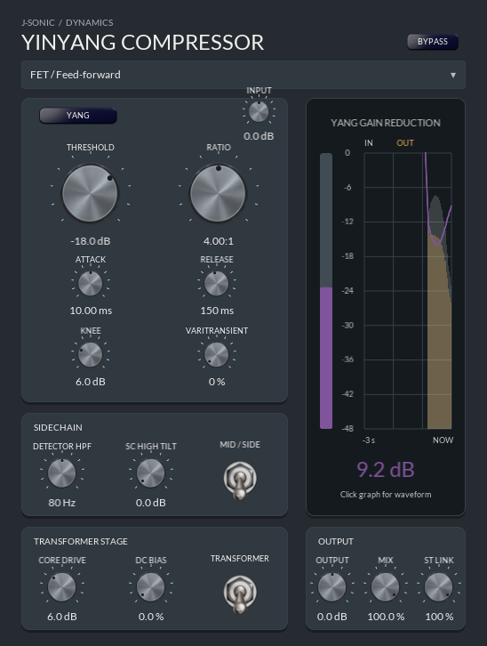

# Yinyang Visage integration: Logic Pro test plan

Status: **Visage editor implemented; macOS host validation remains open**.
The editor hosts Visage inside JUCE, with the Yinyang layout and palette, live
gain and waveform history, knob and switch artwork, typed values, tooltips and
keyboard controls. The original JUCE editor is selectable with
`YINYANG_SOFTWARE_UI=1`. JUCE accessibility controls expose the same parameter
values; native screen-reader behavior needs platform testing.

## Linux results

The Debug VST3 and Standalone builds and the processor, DSP, upward-compression
and oversampling suites pass. Visible editor checks run under Xvfb with a window
manager and Mesa software Vulkan. They exercise 50% and 120% resizing, knob
drags and host gestures, typed threshold and Yin ratio, keyboard and mouse
model selection, waveform toggling, accessibility value actions, and two
concurrent editor instances. The separate JUCE software fallback smoke test
also passes. This does not establish physical GPU, AU/Logic or native
screen-reader compatibility.

## macOS build and validation

1. Build the Yinyang AU and VST3 on the target Mac with the full Xcode toolchain.
2. Validate the AU with `auval -v aufx Chc1 Chra`; record macOS, Logic, GPU,
   architecture, plugin build revision and the complete validation output.
3. In Logic, insert the AU on a stereo audio track and play a signal while
   opening, closing and reopening the editor repeatedly. The GPU surface,
   meter traces and knob-value glows must render without blank or frozen frames.
4. Drag each knob, type values, use switches, automation and tooltips. Verify
   host automation, session recall and touch interactions; compare actual audio
   with the reference build at identical settings.
5. Resize from 50% to 120%, move between displays with different scale factors,
   hide/show Logic and reopen the project. Check crisp text, hit targets,
   waveform interaction, clipping and animations at every size.
6. Exercise all four compressor models, Yin/Yang, transformer on/off, bypass,
   mono/stereo, stopped transport and a sustained signal. Check the waveform
   overlay and gain-reduction history continue updating.
7. Open multiple instances, close individual windows during playback and quit
   Logic. Check for crashes, leaked surfaces, stale callbacks, runaway CPU/GPU
   use and audio dropouts. Repeat with the GPU unavailable or initialization
   failing and verify a usable software fallback.

## Automated checks before Logic

- Build the plugin and existing processor, DSP, upward-compression and
  oversampling tests. Run the editor checks for each supported scale.
- Run `YinyangCompressorTests --gpu-smoke` in a visible desktop session and
  repeat with `YINYANG_SOFTWARE_UI=1` to check both renderer selections.
- Exercise creation, resize, hide/show, teardown and recreation of the embedded
  surface on the UI thread. Verify no graphics access after editor destruction.
- Test event forwarding and focus for mouse, keyboard, text entry and tooltips;
  test that parameter updates and meter data cross threads without locks on the
  audio callback.
- Compare captured frames for visible meter trace and controls in both editor
  paths; include a forced GPU-init-failure case.
- Run GPU-backed window tests on macOS and Linux with real graphics devices;
  a virtual display alone is not evidence of Logic or Metal compatibility.

The Logic acceptance steps remain open; no AU or Logic result is available from
the current Linux environment.
