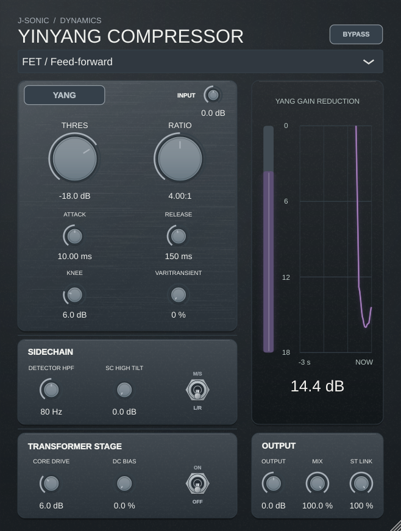

# Yinyang Visage integration: Logic Pro test plan

Status: **experimental GPU renderer implemented on the `visage` branch**.
The existing JUCE editor now paints through JUCE's OpenGL component renderer,
with an automatic software fallback if the context fails to start. This does
not integrate the Visage UI library: doing that would require porting the JUCE
controls and their host event handling. `YINYANG_SOFTWARE_UI=1` forces the
software editor for comparison. A Linux virtual-display smoke test confirms
that OpenGL render callbacks occur while resizing; it does not prove that a
physical GPU or a Logic Pro Audio Unit host accepts the surface.

## Linux results

Release VST3 and Standalone builds pass. The four CTest suites pass, and the
visible-editor smoke test receives OpenGL frame callbacks while switching
between 50% and 120% sizes. A captured Xvfb frame shows the controls and live
gain-reduction trace rather than a blank editor. Repeating the visible-editor
test with `YINYANG_SOFTWARE_UI=1` confirms that the software path remains
available. Xvfb may use a software OpenGL driver, so hardware acceleration
and AU/Logic behavior remain unverified here.

## macOS build and validation

1. Build the Yinyang AU and VST3 on the target Mac with the full Xcode toolchain.
2. Validate the AU with `auval -v aufx Chc1 Chra`; record macOS, Logic, GPU,
   architecture, plugin build revision and the complete validation output.
3. In Logic, insert the AU on a stereo audio track and play a signal while
   opening, closing and reopening the editor repeatedly. The GPU surface,
   meter traces and knob-value glows must render without blank or frozen frames.
4. Drag each knob, type values, use switches, automation and tooltips. Verify
   host automation, session recall and touch interactions; compare actual audio
   with the reference build at identical settings.
5. Resize from 50% to 120%, move between displays with different scale factors,
   hide/show Logic and reopen the project. Check crisp text, hit targets,
   waveform interaction, clipping and animations at every size.
6. Exercise all four compressor models, Yin/Yang, transformer on/off, bypass,
   mono/stereo, stopped transport and a sustained signal. Check the waveform
   overlay and gain-reduction history continue updating.
7. Open multiple instances, close individual windows during playback and quit
   Logic. Check for crashes, leaked surfaces, stale callbacks, runaway CPU/GPU
   use and audio dropouts. Repeat with the GPU unavailable or initialization
   failing and verify a usable software fallback.

## Automated checks before Logic

- Build the plugin and existing processor, DSP, upward-compression and
  oversampling tests. Run the editor checks for each supported scale.
- Run `YinyangCompressorTests --gpu-smoke` in a visible desktop session and
  repeat with `YINYANG_SOFTWARE_UI=1` to check both renderer selections.
- Exercise creation, resize, hide/show, teardown and recreation of the embedded
  surface on the UI thread. Verify no graphics access after editor destruction.
- Test event forwarding and focus for mouse, keyboard, text entry and tooltips;
  test that parameter updates and meter data cross threads without locks on the
  audio callback.
- Compare captured frames for visible meter trace and knob-value glow in both
  software fallback and GPU modes; include a forced GPU-init-failure case.
- Run GPU-backed window tests on macOS and Linux with real graphics devices;
  a virtual display alone is not evidence of Logic or Metal compatibility.

The Logic acceptance steps remain open; no AU or Logic result is available from
the current Linux environment.
