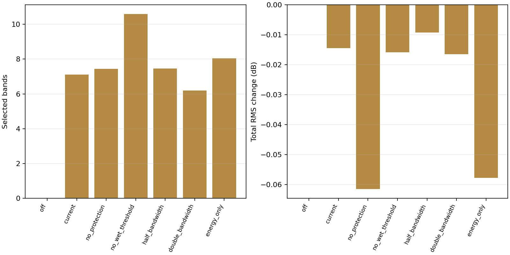
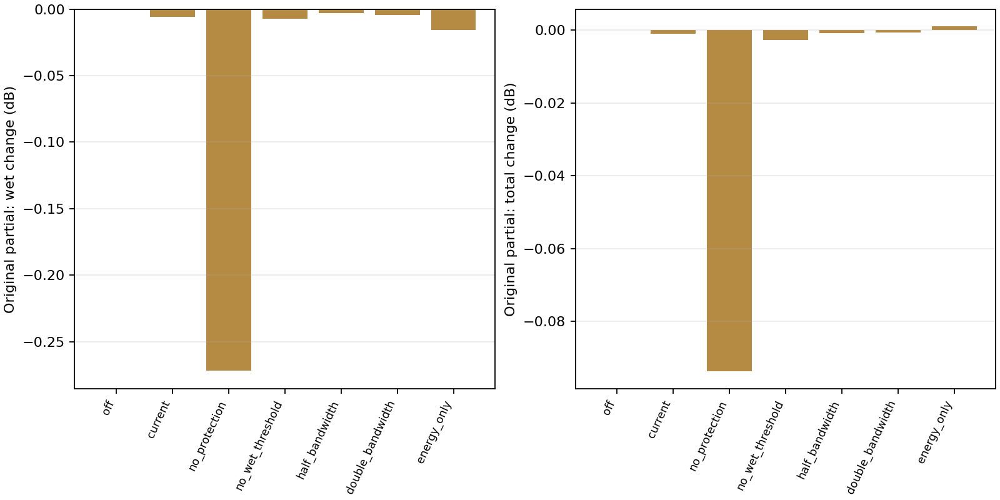

# Zao Drive: synthetic Smart ablations

420 frame/variant conditions across all four production circuits at 44.1/48/96 kHz.



| Variant | Bands | Bands near input partials | Wet RMS Δ dB | Total RMS Δ dB |
|---|---:|---:|---:|---:|
| off | 0.0000 | 0.0000 | 0.0000 | 0.0000 |
| current | 7.1167 | 0.0000 | -0.0272 | -0.0145 |
| no_protection | 7.4333 | 0.5500 | -0.1446 | -0.0615 |
| no_wet_threshold | 10.6000 | 0.0000 | -0.0284 | -0.0159 |
| half_bandwidth | 7.4500 | 0.0000 | -0.0165 | -0.0093 |
| double_bandwidth | 6.2000 | 0.0000 | -0.0306 | -0.0165 |
| energy_only | 8.0500 | 0.0000 | -0.1013 | -0.0578 |



| Variant | Input partial: wet Δ dB | Input partial: total Δ dB |
|---|---:|---:|
| off | 0.0000 | 0.0000 |
| current | -0.0057 | -0.0009 |
| no_protection | -0.2719 | -0.0937 |
| no_wet_threshold | -0.0071 | -0.0028 |
| half_bandwidth | -0.0032 | -0.0008 |
| double_bandwidth | -0.0042 | -0.0006 |
| energy_only | -0.0158 | 0.0010 |

## Protocol

A 4,096-sample periodic frame contains a single tone, a C-like chord, an input-harmonic collision, an inharmonic complex, or seeded periodic noise. Frequencies are exact FFT bins; the source lists their indices, so absolute pitches vary with sample rate. Each tonal mixture has a sum-of-amplitudes ceiling of 0.25, not an equal-RMS normalization. Drive is 24 dB, Input and Output 0 dB, Tone 16 kHz, Mix 100%; Clear, Auto and Transformer are off. BJT Bias is zero and diode Knee 0.5. Six frames warm the actual oversampled circuit and tone path. A research-only tap in `SmartHarmonics::process` captures the aligned dry reference and **actual post-tone driver-minus-reference wet residual**, before Smart filtering. This does not presume the residual contains only harmonics.

Every variant receives the same captured frame. The production RBJ filter bank is loaded through its existing deterministic preview interface; four repeated frames settle its state and the last frame is measured. There is no bank transition or scheduler dependency. Baselines are Smart Off and energy-only selection (`cost=1`, otherwise the same candidate generation and protection). Ablations disable input-peak protection, disable the relative wet-energy threshold, or scale candidate bandwidth by 0.5/2.0. The no-protection fixture includes a harmonic coinciding with one input partial and another non-octave partial, ensuring the dissonance score does not trivially vanish at every protected frequency.

Partial retention is measured by complex sinusoidal projection at each known input frequency in the **filtered wet signal** and in **dry+wet total output**, relative to the identical unfiltered capture. No gain matching or automatic normalization masks attenuation. Total and wet RMS are reported separately. `targets.csv.gz` contains measured Hann-windowed three-bin energy before/after around every selected target, bandwidth, order and cut. `estimated_cost_before/after` are the analyser's own predicted heuristic costs; `measured_target_power_ratio` comes from the real filtered samples and is deliberately separate. Overlapping measurement windows can double-count energy; they are not total distortion power. Protection proximity is evaluated against known fixture frequencies and the selected bandwidth; noisy fixtures have no labelled partials.

The tests assert deterministic target counts/costs, finite output, ≤16 bands, cuts within −6..0 dB, Off identity, noise neutrality, and that the corpus actually changes when protection, threshold or interval weighting is removed. They do not assert a preferred musical outcome.

## Limits

Means pool these synthetic conditions and partials; they are not perceptual scores. This is a frozen stationary filter experiment, not 20 Hz adaptation/crossfade or worker-starvation measurement. The energy-only baseline is deliberately aggressive and is not loudness-matched to the current heuristic. No SPICE, hardware, licensed external processor, established sensory-roughness model, or real-audio validation is represented. A reduction in selected-band power is not proof of greater clarity.


## Rendered Smart on/off spectrograms

| Fixture | Whole wet clash-energy Δ dB | Targeted clash-energy Δ dB |
|---|---:|---:|
| C_chord | -0.015 | -1.219 |
| harmonic_collision | -0.014 | -1.924 |


The paired inputs are the existing 48 kHz op-amp **C-like chord and harmonic-collision fixtures**, not hand-picked output bins. **Clear, Auto compensation, Transformer and Bypass always stay OFF** in these academic tests; Smart alone is varied for the comparison. Input and Output are explicitly 0 dB. At 24 dB drive, Tone 16 kHz and Mix 100%, the real oversampled circuit supplies an aligned dry reference and post-tone wet residual. The captured periodic 4,096-sample frame feeds the real Smart filter bank continuously for 20 cycles; discard four settling cycles and show the remaining 16 (~1.37 s). Off is that same unfiltered wet capture; total output is dry+wet. The frozen production selection removes worker/crossfade timing from this comparison. Repeated material intentionally yields horizontal spectral lines, not a musical passage.

Blue in the difference maps means attenuation, red enhancement, both computed from **actual samples**. Wet and total changes are separate because phase cancellation can increase some dry+wet bins even when the wet bank cuts. Difference bins below −80 dB of the off image maximum are hidden. All on/off levels use identical scales and no gain matching.

“Clash energy” is measured STFT wet power weighted by the production `intervalDissonance(f,input_partial)` averaged over the known, equally weighted input partials. Weights remain fixed for both renders. The table includes the whole wet spectrum and, separately, bins within one bandwidth of any selected production harmonic target (black marks at the left edge). It reports **10 log10(sum weighted on power / sum weighted off power)**; there is no output-dependent normalization. Tests require nonzero target energy and measured attenuation greater than 0.1 dB on both fixtures. This is an operational check of the plugin's own 12-TET heuristic on synthetic signals, not an independent psychoacoustic model or proof that listeners perceive less clash. CSV captures and fixed frequency weights accompany the plots.

All spectrograms derive from native sample captures, using NumPy FFTs and Hann windows without boundary padding. One-sided per-bin power is `|FFT(x*w)|²/(N*sum(w²))`, doubling interior bins; its sum is the window-weighted mean square (0 dBFS = mean square 1). Kuo uses 2,048/256 samples (window/hop), Zao 4,096/256, Xuan 512/32, all at 48 kHz. Phase is masked in silence. Raw captures are gzip-compressed beside this report.

## Reproduce

From the repository root, run:

```sh
python3 projects/run_academic_tests.py --output build/academic-results
python3 projects/generate_academic_reports.py build/academic-results --publish
```

CMake 3.22+, a C++17 compiler and the normal JUCE system dependencies are required. Plot generation additionally needs Python `numpy` and `matplotlib`. Native tests and CTest do not require Python plotting packages. Detailed CSV files are gzip-compressed alongside this report; `provenance.json` records source hashes and build information when run through the launcher. Timing values are machine-dependent.
