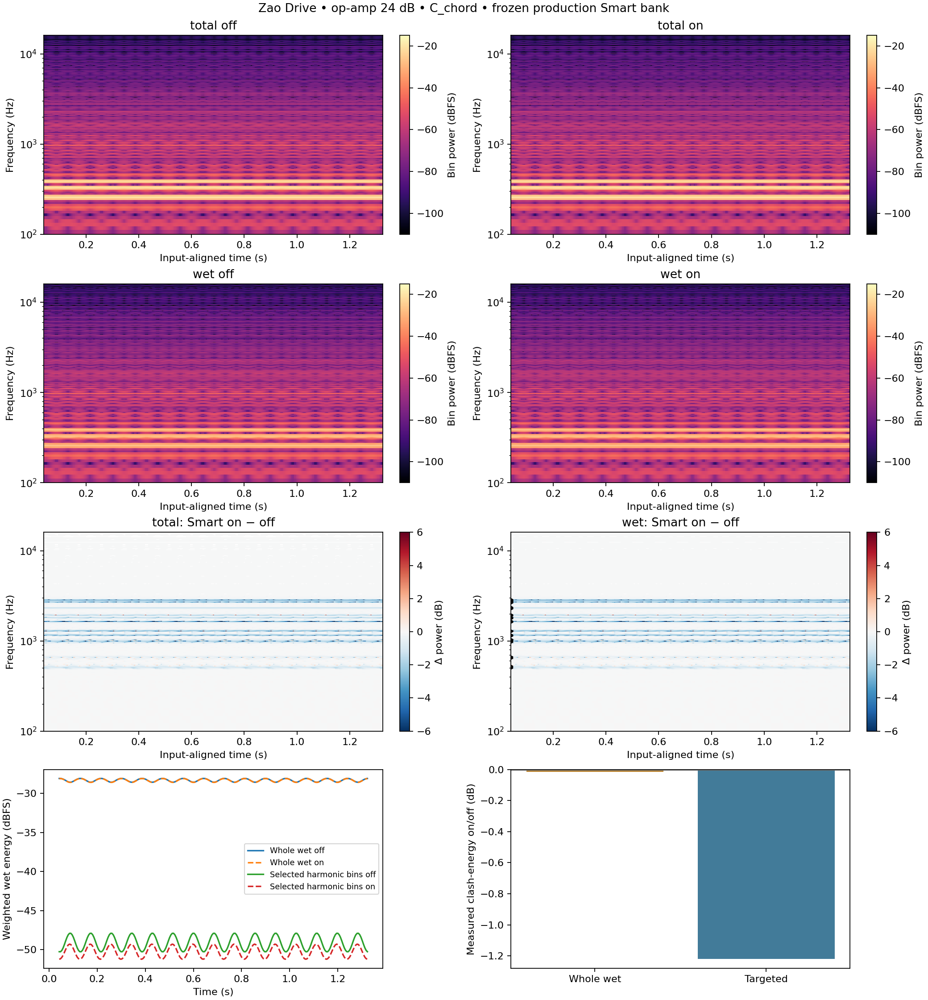
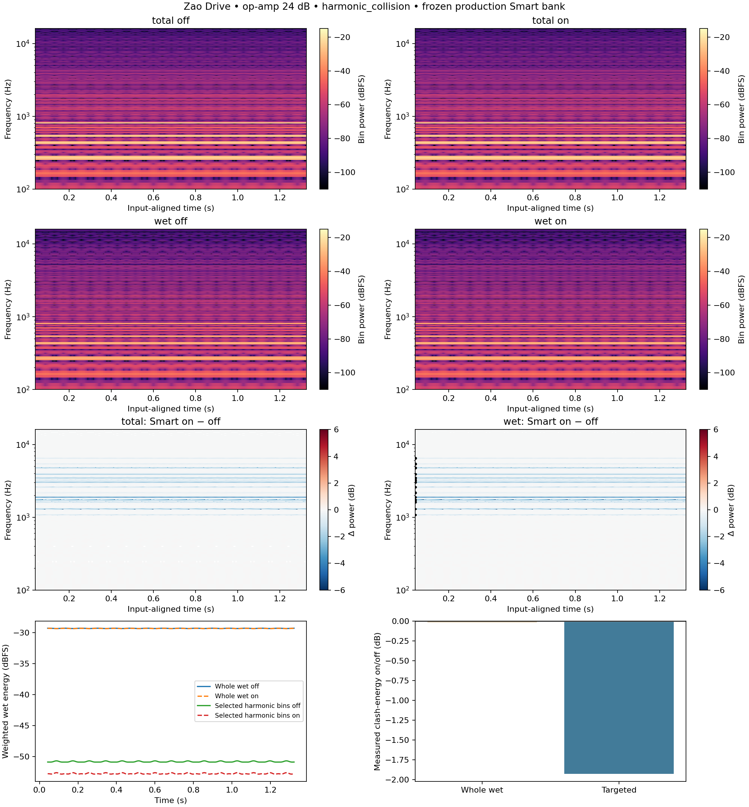

# ZaoDrive: audio spectrogram measurements

## Rendered Smart on/off spectrograms

| Fixture | Whole wet clash-energy Δ dB | Targeted clash-energy Δ dB |
|---|---:|---:|
| C_chord | -0.015 | -1.219 |
| harmonic_collision | -0.014 | -1.924 |

The paired inputs are the existing 48 kHz op-amp **C-like chord and harmonic-collision fixtures**, not hand-picked output bins. At 24 dB drive, Clear/Auto/Transformer off, Tone 16 kHz and Mix 100%, the real oversampled circuit supplies an aligned dry reference and post-tone wet residual. The captured periodic 4,096-sample frame feeds the real Smart filter bank continuously for 20 cycles; discard four settling cycles and show the remaining 16 (~1.37 s). Off is that same unfiltered wet capture; total output is dry+wet. The frozen production selection removes worker/crossfade timing from this comparison. Repeated material intentionally yields horizontal spectral lines, not a musical passage.

Blue in the difference maps means attenuation, red enhancement, both computed from **actual samples**. Wet and total changes are separate because phase cancellation can increase some dry+wet bins even when the wet bank cuts. Difference bins below −80 dB of the off image maximum are hidden. All on/off levels use identical scales and no gain matching.

“Clash energy” is measured STFT wet power weighted by the production `intervalDissonance(f,input_partial)` averaged over the known, equally weighted input partials. Weights remain fixed for both renders. The table includes the whole wet spectrum and, separately, bins within one bandwidth of any selected production harmonic target (black marks at the left edge). It reports **10 log10(sum weighted on power / sum weighted off power)**; there is no output-dependent normalization. Tests require nonzero target energy and measured attenuation greater than 0.1 dB on both fixtures. This is an operational check of the plugin's own 12-TET heuristic on synthetic signals, not an independent psychoacoustic model or proof that listeners perceive less clash. CSV captures and fixed frequency weights accompany the plots.

All spectrograms derive from native sample captures, using NumPy FFTs and Hann windows without boundary padding. One-sided per-bin power is `|FFT(x*w)|²/(N*sum(w²))`, doubling interior bins; its sum is the window-weighted mean square (0 dBFS = mean square 1). Kuo uses 2,048/256 samples (window/hop), Zao 4,096/256, Xuan 512/32, all at 48 kHz. Phase is masked in silence. Raw captures are gzip-compressed beside this report.
